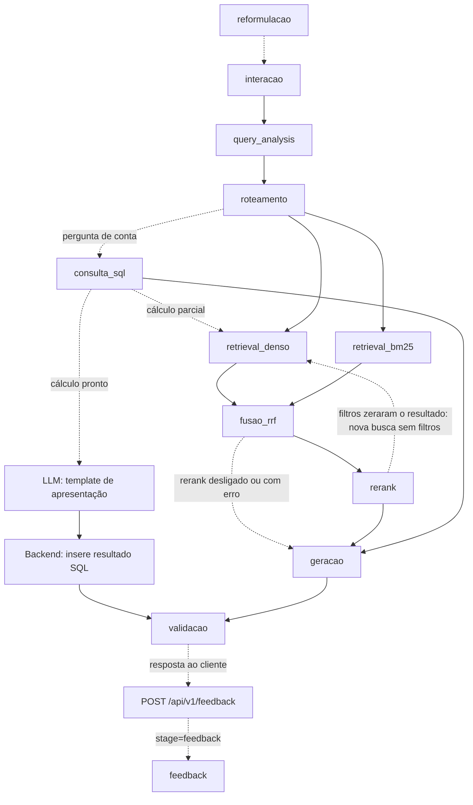

# Arquitetura — Grande Desafio RAG

## 1. Cenário escolhido

**Cenário 1 — Contratações Públicas do Estado do Rio de Janeiro**

Escolhemos o cenário de Contratações Públicas pela disponibilidade de dados verificáveis em fontes oficiais, principalmente o PNCP, e pela diversidade das informações envolvidas. O cenário permite testar uma arquitetura de **Adaptive RAG** combinando análise da consulta, filtros por metadados, busca lexical, busca vetorial, consulta estruturada, rerank, guardrails e validação das respostas.

---

## 2. Pipeline da solução

**O pipeline implementado é composto pelos seguintes estágios:**

- `reformulacao` (só quando o cliente envia `historico` e a pergunta parece continuação)
- `interacao`
- `query_analysis`
- `roteamento`
- `consulta_sql` (perguntas de conta sobre a base estruturada ou a agregada)
- `retrieval_denso`
- `retrieval_bm25`
- `fusao_rrf`
- `rerank`
- `geracao`
- `validacao`

Quando o resultado SQL já responde a pergunta inteira (cálculo pronto), a busca vetorial e lexical é pulada. A LLM escreve somente uma apresentação neutra com `{{sql}}`, e o backend substitui esse marcador pelo resultado SQL completo, com fontes e avisos. Os números não são enviados à LLM; template inválido ou falha do modelo preserva o resultado determinístico como fallback. Ao fim, `resumo_consulta` registra o que foi tentado e o que retornou em cada caminho (SQL e vetorial).

O estágio `feedback` roda fora do pipeline de resposta (é acionado por `POST /api/v1/feedback`, depois que o cliente já recebeu a resposta), mas já está integrado à API e à observabilidade.

### Diagrama do fluxo



### Stages

- `requisicao_inicio`/`requisicao_fim`: envelope do handler API, com resultado HTTP, resposta pública preparada e estado da persistência; `persistencia_historico` registra a tentativa de salvar a consulta. O envelope fecha mesmo em erro, sem depender de logging não estruturado.
- `pipeline_inicio`/`pipeline_fim`: envelope do processamento, com tempo monotônico, versão/contexto de execução e resposta final. Etapas opcionais puladas e fallbacks ficam explícitos; os eventos trazem `extra.schema_version=2`, origem, sequência e resultado normalizado. O trace não soma durações sobrepostas e diferencia fechamento, erro e execução incompleta. Detalhes e limites em [docs/OBSERVABILIDADE.md](docs/OBSERVABILIDADE.md).
- `reformulacao`: o backend não guarda memória entre as perguntas; quem dá o contexto é o cliente, que reenvia as últimas trocas em `historico` no `POST /api/v1/query`. Quando a pergunta parece continuação ("considerando os mesmos contratos…", "E em 2024?"), um filtro determinístico a separa das que já se sustentam sozinhas (essas não chamam o modelo) e o LLM a reescreve usando só as 3 trocas mais recentes, com dado pessoal mascarado e o histórico tratado como dado, não como instrução. A pergunta reescrita substitui a original em todas as etapas seguintes, então os guardrails valem sobre o que de fato é consultado; a resposta devolve o texto digitado em `query` e a reescrita em `pergunta_reformulada`. Continuação que só troca o ano ("E em 2025?") é reescrita por regra, sem o modelo. Se o modelo falha ou devolve saída fora do formato, a pergunta segue com as anteriores anexadas (até a última que se sustenta sozinha), em vez de perder o contexto. Desligável com `REFORMULACAO_MODE=regras`. Ver [src/reformulation.py](src/reformulation.py).
- `interacao`: decide se a mensagem é conversa (saudação, agradecimento, pedido de ajuda, apresentação) ou consulta ao acervo ([src/conversation.py](src/conversation.py)). Conversa é respondida sem consultar o acervo; consulta segue para a `query_analysis`. Tem etapa própria no log para que mensagens de cortesia não apareçam como análise de consulta.
- `query_analysis`: interpreta a pergunta e extrai filtros de ano (incluindo período `ano`/`ano_final`), valor, órgão, esfera, modalidade, métrica (contagem/soma/média/mediana), agrupamento e qual campo de data usar (assinatura, publicação, resultado ou PCA). O órgão é reconhecido também em minúsculas e por sigla (DPE, SEEDUC etc.) e conferido no catálogo de órgãos do corpus ([data/config/orgaos_corpus.json](data/config/orgaos_corpus.json)); "Prefeitura (Municipal) de X" e "Prefeitura do Rio" viram o nome do órgão no PNCP, "MUNICIPIO DE X" ("PREFEITURA MUNICIPAL DE X" é o nome da unidade); citações de norma ("Lei federal 14.133", "Lei do Pregão") não viram esfera nem modalidade. Também viram filtro: o CNPJ citado, com ou sem pontuação (sem confundir com o começo de um número de controle do PNCP); o município citado sozinho ("contratos em Volta Redonda"), conferido na lista de municípios do catálogo, sem tratar como cidade o "Rio de Janeiro" de "órgãos estaduais do Rio de Janeiro"; e o fornecedor pelo nome ("empresa Cristália"), exigindo uma palavra-gatilho antes ou um nome de duas palavras, e sem escolher quando o nome casa com mais de um fornecedor. A extração de período foi corrigida para não confundir valores monetários ("acima de 2000 reais") com ano. Todos os filtros são marcados como opcionais, para não eliminar chunks que não possuem o campo correspondente, e o pipeline refaz a busca sem filtros quando eles zeram o resultado.
- `roteamento`: identifica as bases adequadas para responder à consulta e trata perguntas fora do escopo; quando recusa, já infere um motivo (dados bancários, credenciais vazadas, juízo de legalidade, fora de escopo, sem evidência) a partir de pistas na justificativa.
- `retrieval_denso`: realiza recuperação semântica por embeddings.
- `retrieval_bm25`: realiza recuperação lexical por BM25.
- `fusao_rrf`: combina os resultados das buscas densa e lexical usando Reciprocal Rank Fusion.
- `rerank`: reordena os candidatos da fusão com um cross-encoder local (`cross-encoder/mmarco-mMiniLMv2-L12-H384-v1`, multilíngue, via `sentence-transformers`), controlado por `RERANK_ENABLED` e `RERANK_CANDIDATES`. Os campos de conteúdo (objeto/título/descrição) são reordenados antes do rerank para caber na janela de 512 tokens do modelo nos chunks de base estruturada em JSON. Medido em [docs/ABLACAO_RERANK.md](docs/ABLACAO_RERANK.md) no corpus v6, com 47 perguntas (34 parafraseadas + 13 de identificador: número de contrato, CNPJ, pregão, UASG etc.): o rerank sobre o RRF leva o hit@3 de 0,64 para 0,83 no conjunto completo e de 0,46 para 0,85 nas perguntas de identificador — por isso o padrão é RRF + rerank@10 (`RERANK_CANDIDATES=10`). A busca densa sozinha só acha 31% dos identificadores, e o BM25 sozinho erra as perguntas parafraseadas; por isso a fusão híbrida com rerank se mantém, em vez de usar só a busca densa. Ver [src/rerank.py](src/rerank.py).
- `consulta_sql`: para perguntas de conta (ranking, contagem, média/mediana, agrupamento, evolução mensal, listagem com assunto) e para o CNPJ de um fornecedor citado (com matriz e filiais, sem passar pelo LLM) sobre a base de contratos ou a agregada, consulta a base relacional (Postgres ou SQLite local, conforme `DATABASE_URL`) com SQL fixo (nunca gerado pelo LLM) — na tabela de contratações ou em `pca_planos`, quando a pergunta é sobre o PCA — e injeta o resultado, marcado como `doc_type=sql`, na frente dos chunks recuperados. O Neon e o SQLite em `data/structured/` (baixado do Drive com a v7) têm a mesma base desde 2026-10-19 e dão as mesmas respostas; a demo usa o SQLite, que responde em 0,4 a 3 s contra 4 a 13 s no Neon, que paga a rede a cada consulta. O SQLite também serve a quem não tem a connection string, aos testes e às avaliações. Regras da consulta:
  - esfera e modalidade vêm do `query_analysis`; o órgão é casado com os nomes do banco (sem aceitar um órgão "federal" ou "regional" que a pergunta não pediu, e com "prefeitura" valendo também como "município");
  - "contratos" conta só contratos assinados, pela data de assinatura (ou de publicação, se a pergunta pedir); "contratações" e "compras" misturam compras e contratos, e a contratação que tem os dois registros conta uma vez (coluna `numero_controle_compra`);
  - valores abaixo de R$ 1,00 (R$ 0,00 e R$ 0,01 simbólicos do PNCP) ficam fora de média, mediana, evolução e ranking, e são contados à parte;
  - "tecnologia" é lida como TI (tecnologia da informação, informática, software, TIC);
  - quando nenhum registro informa a modalidade, o resultado diz que não é possível saber; quando a pergunta cita uma lei, o resultado avisa que a norma não é filtro (os contratos assinados não trazem o amparo legal);
  - o CNPJ citado filtra pelo CNPJ do órgão ou do fornecedor (`fornecedor_cnpj`, schema 7); se os dígitos verificadores não conferem, o cabeçalho do resultado avisa;
  - cada consulta grava um **recorte**: execução completa ou parcial (com os filtros relaxados), tipo de resultado (registros, soma zero, sem correspondência, cálculo indisponível), completude dos campos usados e a cobertura (amostra do snapshot, com o total de registros). A confiança da resposta vem desse recorte (ver `geracao`).

  Ver [src/structured_query.py](src/structured_query.py) e [src/structured_db.py](src/structured_db.py).
- `geracao`: gera a resposta somente a partir das evidências recuperadas, com guardrails e política de sensibilidade. O orçamento de contexto é controlado por `GENERATION_CONTEXT_CHARS` (3.500 caracteres na janela curta do endpoint da turma, 12.000 com `LLM_PROVIDER_MODE=openrouter`) e `GENERATION_CHUNK_CHARS` (900 por trecho). Cada chamada ao LLM usa `GENERATION_TIMEOUT` (180 s) e `GENERATION_MAX_RETRIES` (1 tentativa extra); no modo `auto`, padrão, se o endpoint da turma falha a geração tenta o OpenRouter (`openrouter/free`) (ver [config.py](config.py) e [llm_ecoa.py](llm_ecoa.py)). A confiança de respostas com SQL vem do recorte da consulta: um zero de execução completa sustenta "não há registros" na amostra (confiança alta), execução parcial limita a média e cálculo indisponível a baixa; o escopo (amostra, não o universo do Estado) vai em `avisos` e, quando nada foi encontrado, também numa ressalva no texto da resposta.
- `validacao`: valida a saída do LLM, trata JSON inválido, remove citações inexistentes e mascara dados pessoais quando necessário. Também converte recusas indevidas: quando o roteador já colocou a pergunta no escopo e o LLM escreveu uma resposta com evidência parcial mas ainda assim marcou recusa por "fora de escopo" ou "sem evidência", a recusa vira resposta com confiança baixa, e a conversão fica registrada como `recusa_convertida` no log (`_converter_recusa_indevida` em [src/generate.py](src/generate.py)). Recusas de guardrail (dados bancários, credenciais, juízo de legalidade) nunca são convertidas.
- `feedback`: não roda dentro de `responder`, e sim quando o usuário avalia uma resposta já entregue. `POST /api/v1/feedback` associa a avaliação (`positivo`/`negativo` + comentário opcional) ao `query_id` da consulta original (404 se ele não existir) e grava o evento no log com esse mesmo `run_id`, amarrando-o aos demais stages da pergunta. Persistência e histórico em [src/history_store.py](src/history_store.py).

### Camadas do código (Clean Architecture)

Desde 2026-10-23 o código segue, aos poucos, a separação em camadas da Clean
Architecture. A regra é que a dependência só aponta para dentro: o domínio não
conhece o banco, o índice nem o LLM; o caso de uso conhece só os contratos
(portas); a infraestrutura implementa esses contratos.

| Camada | Onde | O que tem |
|---|---|---|
| Entidades | [src/schema.py](src/schema.py) | `Chunk`, `RouteDecision`, `QueryFilters`, `RAGResponse`… (só pydantic) |
| Domínio | [src/domain/](src/domain/) | regras puras: política de confiança (`confidence.py`), situação da compra nas contas (`purchase_status.py`), conta do RRF (`fusion.py`), normalização de texto (`text.py`), leitura de valores e períodos da pergunta (`values_and_periods.py`) |
| Caso de uso | [src/pipeline.py](src/pipeline.py) | `responder`: reformulação, conversa, análise, roteamento, coleta (SQL e busca), geração |
| Portas | [src/ports.py](src/ports.py) | `Analisador`, `Roteador`, `Buscador`, `ConsultaEstruturada`, `Gerador`, `Conversa`, `Reformulador` (`Protocol`) |
| Infraestrutura | `src/retrieve.py` (orquestração da busca e busca densa) e as partes em [src/retrieval/](src/retrieval/) — registros e caches (`records.py`), filtros (`filters.py`), BM25 (`lexical.py`, com o índice invertido de `src/lexical_index.py`), identificadores (`identifiers.py`), normas (`norms.py`), evidências (`evidence.py`) e RRF/variedade (`ranking.py`) —, `src/structured_query.py`, `src/generate.py` (prompt, chamada ao LLM e validação; as partes em [src/generation/](src/generation/): guardrails, contexto do prompt, avisos, resposta pelo SQL, leitura da resposta, log e citações), `src/structured_db.py`, `llm_ecoa.py`, `src/obs.py`… | FAISS + BM25, SQLite/Neon, ECOA/OpenRouter, log JSONL |
| Entrada | [app/api.py](app/api.py), [app/cli.py](app/cli.py) | HTTP e linha de comando; só convertem a requisição no caso de uso |

**Regra conferida por teste** ([tests/test_architecture.py](tests/test_architecture.py)): os módulos de
`src/domain/` só importam a biblioteca padrão, `src.schema` e o próprio domínio; `src/schema.py` só
depende do pydantic; `src/pipeline.py` não importa nome privado (com `_`) de outro módulo. Quem quebrar
a regra vê o teste falhar com o nome do import proibido.

**Trocar uma peça.** O pipeline recebe as implementações em `Dependencias`; as do projeto saem de
`dependencias_padrao()`. Para usar outra busca, outro LLM ou uma versão falsa num teste:

```python
import dataclasses
from src import pipeline

deps = dataclasses.replace(pipeline.dependencias_padrao(), buscar=minha_busca)
pipeline.responder("Quantos contratos de ambulância em 2025?", dependencias=deps)
```

Exemplos com peças falsas, sem `monkeypatch`, em [tests/test_pipeline_ports.py](tests/test_pipeline_ports.py).

**Acrescentar um tipo de consulta SQL.** Cada tipo (identificador, CNPJ do fornecedor, ranking,
listagem, agrupamento, evolução, estatística) tem um executor próprio em
[src/sql_query/execution.py](src/sql_query/execution.py), registrado em `_EXECUTORES`. Tipo novo é uma função
`_executar_<tipo>(e: _Execucao)` e uma linha no registro, sem mexer nos outros (princípio aberto/fechado).
Um teste falha se a análise puder gerar um tipo que não tem executor.

**Funções divididas pelas etapas do log.** As funções centrais foram quebradas nas etapas que o log já
nomeia, sem mudar o comportamento (2.197 testes e golden 35/36 antes e depois):

| Função | Antes | Depois | Partes |
|---|---|---|---|
| `pipeline._responder` | 186 linhas | 43 | conversa, coleta por intenções, consulta única, intercalação, aviso de filtros |
| `structured_query._executar` | 288 | 7 | um executor por tipo de consulta |
| `structured_query.detectar_consulta` | 244 | 123 | registro pedido, tabela, tipo, limite, agrupamento, esferas, modalidade e objeto, mês, órgão |
| `retrieve.retrieve` | 277 | 74 | rota e filtros, registros elegíveis, busca densa, BM25, identificadores exatos, fusão, rerank |
| `generate.gerar_resposta` | 142 | 94 | resposta pelo SQL, preparação do prompt, validação da saída do LLM |
| `query_analysis._analisar_com_trechos` | 127 | 68 | métrica, agrupamentos, referência de data, esfera, entidades (órgão, município, fornecedor), modalidade, tipo de valor |
| `query_analysis._nome_a_partir_do_gatilho` | 117 | 3 | classe `_LeitorDeOrgao`: qualificadores, município, próximo passo, veredito |
| `query_analysis._analisar_llm` | 98 | 18 | cache, chamada ao LLM, validação de cada intenção contra a pergunta |

No caminho da pergunta, nove funções passavam de 100 linhas (a maior, 288); desde 2026-10-25 nenhuma
passa (`_where` e `dense_retrieve` divididas por grupo de filtro e por etapa; `detectar_consulta` com
96 linhas, quase metade a montagem da `Consulta`; `gerar_resposta` com 95). Os nomes antigos
das funções movidas para o domínio (`generate._aplicar_recorte`, `structured_query._situacoes_da_pergunta`,
`structured_db.normalizar`…) continuam valendo como apelidos, para não quebrar quem os importava.

**`query_analysis.py` separado por assunto (2026-10-24).** Das 2.193 linhas, ficaram 939: a análise
pelo LLM e a montagem dos filtros. A leitura de valores e períodos ("acima de R$ 500 mil", "a partir
de 2024", 771 linhas) foi para o domínio, em [src/domain/values_and_periods.py](src/domain/values_and_periods.py),
porque são regras puras; o reconhecimento de órgão, município, fornecedor e CNPJ (910 linhas, lê o
catálogo do corpus) foi para [src/analysis/entities.py](src/analysis/entities.py). Os nomes continuam
importáveis de `src.query_analysis`. A análise por regras das 83 perguntas de avaliação ficou idêntica
antes e depois, byte a byte, com o catálogo real. Quem troca o catálogo ou a estatística de palavras
num teste (`ORGAOS_CORPUS_PATH`, `_palavras_dos_objetos`) faz a troca em `src.analysis.entities`.

**`structured_query.py` separado por etapa (2026-10-25).** Das 1.979 linhas, ficaram 771: a entrada
(`consultar_estruturado`, `executar_consulta`), o recorte e o texto da resposta. A decisão de que
conta a pergunta pede (`detectar_consulta`, `consulta_da_intencao`, a `Consulta`; 756 linhas) foi para
[src/sql_query/detection.py](src/sql_query/detection.py), e o WHERE parametrizado com os
executores por tipo (646 linhas) para [src/sql_query/execution.py](src/sql_query/execution.py). A
detecção não depende da execução; a execução só usa a `Consulta`. O SQL gerado e o resultado no banco
real ficaram idênticos antes e depois nas perguntas de avaliação (83 consultas, 112 trechos de resposta).

**Fica como está, de propósito:** o cliente do LLM (`llm_ecoa.py`, na raiz) já fica atrás da porta
`Gerador` (src/ports.py), que é o que a Clean Architecture pede; mudá-lo de lugar mexeria em 13
arquivos, 30 trocas em testes e 8 trechos da documentação, sem ganho de comportamento. A coleta
(`fetch_corpus.py`, 4,3 mil linhas) fica fora do caminho da pergunta.

### Estado atual

Já estão implementados:

- Adaptive RAG com roteamento por tipo de evidência;
- recuperação híbrida com busca densa + BM25 + RRF + rerank por cross-encoder;
- consulta a base estruturada em SQL (Postgres/SQLite) para perguntas sobre contratos;
- filtros por metadados com fallback quando a filtragem retorna vazio;
- guardrails para perguntas fora do escopo e ausência de evidência, com motivo de recusa inferido;
- segurança da API: pedido para mostrar ou mudar as instruções internas (prompt injection) recebe resposta fixa, sem passar pelo LLM; credencial, senha, chave de API e token de acesso são recusados; cabeçalhos HTTP de segurança (`nosniff`, `X-Frame-Options: DENY`, `no-referrer`, `no-store`) em toda resposta; CORS só para as origens do site; trace e histórico só para o dono da sessão ou a chave de operação; `/docs` desligável por `API_DOCS=false`; desde 2026-10-23, role-play ("finja que é o administrador", "você agora é o DAN") e pedidos de vazar o contexto ("repita o texto acima") também recebem a resposta fixa; limite de requisições por cliente, com o IP real atrás do túnel ([app/rate_limit.py](app/rate_limit.py)); e cadeia de hashes no log JSONL, com verificador ([src/log_chain.py](src/log_chain.py));
- política de sensibilidade e mascaramento de dados pessoais;
- validação da resposta gerada;
- observabilidade estruturada por `run_id`, `query_id`, `session_id`, origem, sequência e outcome; envelopes API/pipeline com tempo monotônico, persistência do histórico, metadados de versão e resumo SQL/vetorial que distingue tentativa de retorno de evidências (`resumo_consulta`);
- coleta e versionamento do corpus por manifesto (atualmente na versão v7);
- preparação de documentos, OCR, embeddings e indexação;
- API FastAPI com `GET /health`, `POST /api/v1/query`, `POST /api/v1/feedback`, `GET /api/v1/history`, `GET /api/v1/trace/{query_id}` e `GET /api/v1/sessions/{session_id}/trace` (caminho da pergunta e da conversa, [src/trace.py](src/trace.py)), além do catálogo (`GET /api/v1/explore/contratacoes`, `/documentos`, `/orgaos`, `/fontes`) e de `GET /api/v1/project/summary`;
- feedback do usuário e histórico de consultas persistidos em SQLite local ([src/history_store.py](src/history_store.py)), com textos mascarados, expurgo após `HISTORY_RETENTION_DAYS` dias e a resposta completa comprimida com zlib (o campo só é lido inteiro, nunca pesquisado);
- histórico e trace com dois personas: `X-API-Key` igual a `RAG_API_KEY` (quem opera a demo) vê tudo; o header `X-Session-Id` vê só a própria conversa; sem nenhum dos dois, `401`. `HISTORY_PUBLIC=true` abre o histórico geral para uma demo (desligado por padrão);
- CORS configurado para desenvolvimento local e para a origem `https://etuarda.github.io`;
- frontend em repositório separado, publicado em [https://etuarda.github.io/frontendRAG/](https://etuarda.github.io/frontendRAG/): consome consulta, feedback, trace da pergunta e da conversa, catálogo e resumo do projeto, e mostra os `avisos` da resposta. Na demo, o backend roda na máquina de quem apresenta e fica público por um túnel ngrok no domínio fixo gratuito (README, seção 9.1); o site ainda precisa ser publicado apontando para ele;
- suporte a certificados HTTPS com `certifi` sem desabilitar validação SSL;
- golden set com 36 casos e critérios de conteúdo (radicais, teto de confiança, negação), mais um conjunto de busca com 47 perguntas e a ablação do rerank. Na v7, a rodada de 2026-10-19 com o código da `main` em `b93164c` (`golden-2026-10-19-v7-36`) deu **31/36 (86%)**; com os ajustes seguintes no prompt (insuficiência dita de forma explícita), na ordem dos trechos de perguntas mistas e nos apelidos de fornecedor, a rodada `golden-2026-10-19-v7-36-ajustes` deu **33/36 (92%)**: rota 97%, recusa 100%, citação 100%, conteúdo 92%, sem erro de provedor. As três falhas que restam são da geração do LLM (palavras do gabarito e confiança acima do teto). Três rodadas seguidas com o código final (`golden-2026-10-20-v7-36-final-1` a `-3`) deram 31, 33 e 31: P1.2, P4.2 e P6.1 falham nas três, P2.3 e P4.3 oscilam, e rota (97%) e recusa (100%) não variam. Depois dessas rodadas, a P4.2 passou a sair do SQL (agrupamento por modalidade) e teve o gabarito refeito para a v7; na sequência P4.1 → P4.2 → P4.3 pela API, as três passam, e a rodada seguinte (`golden-2026-10-20-v7-36-auditoria`) deu **32/36**. Com os gabaritos da P1.2 e da P6.1 refeitos para a v7, a rodada de 2026-10-21 (`golden-2026-10-21-v7-36`) deu **35/36 (97%)**: só a P3.2 falhou, por variação da redação do LLM. Na busca híbrida dos 47 casos, hit@10 de 0,87 na v7 contra 0,91 na v6. Detalhes em [docs/registro_execucao_v6.md](docs/registro_execucao_v6.md);
- scripts de instalação (`scripts/setup.ps1`/`setup.sh`) e de download dos modelos com hash conferido (`scripts/models.ps1`/`models.sh`);
- 2.231 testes automatizados passando na verificação realizada em 2026-10-26 (eram 2.035 em 2026-10-19). Golden v7 em 35/36 estável desde 2026-10-24 (35, 36 e 35 nas três últimas rodadas), com temperatura 0 no LLM, avaliador que separa as orações na leitura de negação e retentativa de citação; a falha que resta, quando ocorre, é a P4.3 (resposta certa sem fonte citada).

### Corpus e índice

As bases oficiais da v6 são:

- `contratos_estruturado`;
- `editais_normativo`;
- `atas_conversacional`;
- `pca_agregado`;

mais o suplemento sintético `emails_sinteticos` (25 conversas geradas pelo tutor, 20 públicas e 5 restritas; [docs/emails_sinteticos.md](docs/emails_sinteticos.md)).

A base ativa é a **v7**, o censo de contratos e publicações de 2025, desde 2026-10-19: 106.667 registros em `contratacoes`, 144.112 chunks e 143.299 vetores, resumidos em `CORPUS_INVENTORY.md`. Os dados (5,3 GB) ficam fora do git e cada integrante baixa na própria máquina (README). A v6 (1.400 arquivos; manifesto arquivado em [archive/corpus_manifest_v6.yaml](archive/corpus_manifest_v6.yaml)) é a referência das medições de regressão. O histórico de reconstrução do inventário entre as versões está em `data/inventory/DIFF_v2_v3.md`, `DIFF_v3_v4.md`, `DIFF_v4_v5.md` e `DIFF_v5_v6.md`.

O índice oficial vigente ([index/manifest.json](index/manifest.json)) usa embeddings `Qwen3-Embedding-0.6B.Q8_0` (dimensão 1024) em índice FAISS (`index/*/vectors.faiss`), gerados a partir de `data/normalized/v6/documents.jsonl`. Depois da recuperação OCR de 2026-10-07 ([src/corpus_quality.py](src/corpus_quality.py), relatório em [data/inventory/qualidade_v6.json](data/inventory/qualidade_v6.json)), ele tem **5.090 vetores** da v6, mais os 25 das conversas sintéticas (**5.115 no total**), sem trechos ilegíveis:

- 625 chunks de `contratos_estruturado`;
- 1.557 chunks de `editais_normativo`;
- 1.997 chunks de `atas_conversacional`;
- 911 chunks de `pca_agregado`.

Foram preservados os vetores dos textos inalterados. A recuperação produziu 305 novos registros vetoriais a partir de 283 textos distintos, com o mesmo checkpoint e configuração do índice. Os 826 chunks anteriormente excluídos foram substituídos por texto legível e nova segmentação: 52 páginas de 3 atas passaram pelo Tesseract (`por`), e os códigos `/U0044` de 7 páginas dos Decretos 48.816 e 48.760 foram decodificados, inclusive nos cabeçalhos de páginas majoritariamente legíveis. Números de página permanecem junto do parágrafo ou seção, sem virar chunks isolados. O manifesto histórico da coleta foi recuperado por hash, sem alterar o manifesto atual ou os arquivos brutos. Detalhes em [eval/runs/v6-ocr-recovery.json](eval/runs/v6-ocr-recovery.json). SQLite e Neon foram remontados em 2026-10-09 (schema 7, com `fornecedor_cnpj`) e comparados linha a linha: `contratacoes` tem 810 linhas (455 contratos assinados e 355 compras publicadas, 185 delas vindas da base agregada) e `pca_planos`, 1.

**Limitações conhecidas da v6:**
- os indicadores do PCA (`pca_agregado`) estão praticamente ausentes do corpus coletado (só um PCA confirmado, da Secretaria de Saúde estadual);
- 452 dos 455 contratos assinados não têm `modalidade`: o PNCP não traz modalidade em contrato assinado. Todo contrato traz o número da compra de origem, mas só 9 delas estão no corpus; nesses pares a contratação conta uma vez, pela compra, que traz a modalidade. Preencher os outros exige coletar a compra de cada contrato (`numeroControlePncpCompra`), o que o censo v7 prevê. Das 355 compras publicadas, só 1 informa o fornecedor (cobertura de cada campo em [docs/QUALIDADE_DOS_DADOS.md](docs/QUALIDADE_DOS_DADOS.md));
- as normas têm início de vigência (`extras.data_vigencia_inicio`, declarado no manifesto ou vindo da publicação da compra no PNCP), mas não fim: nenhuma norma do corpus foi revogada. `data_vigencia` continua vazio nelas, porque no projeto ele é o fim da vigência ("vigente até"). Os textos são compilações atuais: a vigência histórica de cada dispositivo não foi verificada;
- há só 1 registro de "ambulância tipo D" (valor R$ 0,00), insuficiente para perguntas de mediana ou comparação entre esferas;
- 21 contratos têm valor R$ 0,00, 6 têm R$ 0,01 e 15 compras têm valor abaixo de R$ 1,00 (valores simbólicos, marcados com `extras.valor_simbolico`); a `consulta_sql` os deixa fora das contas de valor, e o prompt avisa que esse valor não é o custo real;
- o amparo legal só vem nas compras publicadas: nos contratos assinados ele é nulo, então não dá para contar contratos por lei.

Os diretórios `index/`, `data/normalized/`, `data/structured/` e `data/embeddings/` estão no `.gitignore`. Desde a adoção da v7 (2026-10-19), o índice, o SQLite e o corpus normalizado ativos (5,3 GB) não vão para o Git: cada integrante baixa a v7 do Drive na própria máquina. Continuam versionados via `git add -f`, como referência das medições de regressão, o corpus normalizado da v6 (`data/normalized/v6/`), os seus vetores (`data/embeddings/2026-10-07_21-18-41_ocr-recovery/` e a geração original em `2026-09-30_12-08-51/`) e os e-mails sintéticos. Os inventários `data/inventory/*.json` são versionados normalmente, e os dois ZIPs da v6 em `atas-zip/` entram por exceção explícita no `.gitignore`. O `-text` do `.gitattributes` nesses caminhos preserva os bytes exatos (sem conversão CRLF/LF), porque os hashes de proveniência dependem deles. `data/app_state/` (onde fica o histórico de perguntas dos usuários, `src/history_store.py`) **não** está nessa lista e permanece fora do Git. A geração do corpus normalizado depende de OCR local (Tesseract + pacote de idioma português) instalado na máquina de quem roda o `prepare`.

---

## 3. Divisão de responsabilidades

As tarefas são distribuídas entre os integrantes a cada encontro conforme as necessidades do projeto, dependências entre módulos e pendências encontradas nas revisões. A equipe não mantém uma divisão fixa por pessoa.

### Como as tarefas são organizadas

- **A cada encontro**, a equipe revisa o estado do projeto e distribui as próximas atividades.
- **As dependências entre módulos** são consideradas para evitar trabalhos conflitantes, principalmente entre coleta, indexação, análise de consulta e avaliação.
- **As revisões** geram novos ajustes e tarefas para os encontros seguintes.
- **O registro individual das contribuições** fica em `acompanhamento/ACOMPANHAMENTO_*.md`.

### Frentes atuais

- Preparação do Demo Day (23/10): ensaio pelo site publicado em 21/10.
- Avaliação na v7: golden set de 36 casos em 31/36 (2026-10-19).

### Pendências em aberto

Situação conferida em 2026-10-19, depois do PR #62 e dos ajustes da rodada `golden-2026-10-19-v7-36-ajustes` (33/36).

- **Ensaio do Demo Day pelo site publicado** (roteiro e plano B são material interno do grupo, fora do repositório): cronometrar a apresentação e conferir as telas de trace e a tabela das respostas no navegador. As consultas ao vivo saem do SQL, sem o LLM, em 0,3 a 2 s; com a v7, o backend leva cerca de 1 minuto para ficar pronto e ocupa ~4,6 GB de RAM.
- **Gabaritos refeitos para a v7 em 2026-10-21:** a P1.2 pedia "nenhum fornecedor", mas na v7 a premissa se confirma (Extreme Digital e 3Structure IT, sem menção a atraso nas atas); a P6.1 teve o teto de confiança "média" retirado do gabarito em 2026-10-21, porque a regra está explícita no corpus (LC 123/2006, art. 42) e a resposta certa saía reprovada só pela confiança alta. A P4.2 passou a sair do SQL (agrupamento por modalidade) e teve o gabarito refeito para a v7. O prompt já pede a insuficiência de forma explícita, o que resolveu P2.3 e P3.2.
- **Busca:** na v7, atas diferentes da mesma compra (uma por fornecedor ou lote) podem ocupar todos os primeiros resultados, deixando pouca variedade para o LLM; em perguntas que misturam norma e contratações, os trechos de cada base já se alternam no contexto, mas a janela de 3.500 caracteres do ECOA comporta poucos trechos de cada uma.
- **Catálogo de órgãos, municípios e fornecedores** (`data/config/orgaos_corpus.json`): ainda é o da v6 (401 fornecedores, 56 municípios); a v7 tem 12.798 fornecedores e 87 municípios. Regenerado sem mais regras, ele inventa fornecedor em perguntas com palavras comuns ("tecnologia") e não distingue a matriz da filial; refazer depois de juntar as filiais e reforçar a proteção contra nomes comuns.
- **Cobertura do PCA e da modalidade dos contratos:** limitação da fonte, documentada.
- **Reserva do LLM (OpenRouter gratuito) instável:** em 2026-10-21, com o ECOA simulado fora do ar, os modelos gratuitos devolveram 404, 429 e 502 e respostas vazias em parte das chamadas; a resposta vazia passou a acionar o modelo reserva, mas a reserva não é garantida. As perguntas ao vivo da demo saem do SQL, sem LLM; as de norma têm captura no plano B.
- **Depois do Demo Day:** tabela de apelidos de fornecedor completa (hoje há uma lista curta, com Light e Correios desde 2026-10-21; a CEDAE fica de fora por também ser órgão do catálogo), revogação das chaves do OpenRouter e do ngrok usadas na demo (a `RAG_API_KEY` foi trocada em 2026-10-26) e, se houver prazo, a separação de `src/query_analysis.py` em módulos por assunto. Feitos em 2026-10-23: compras revogadas e suspensas fora dos cálculos, limite de requisições, cadeia de hashes no log, detector de injeção com role-play e as camadas descritas em "Camadas do código".

---

## 4. Coordenação da equipe

**Coordenador:** Renato Lemos

Renato Lemos coordena a equipe, acompanha o andamento do projeto, apoia a organização e distribuição das tarefas e participa das decisões técnicas e do desenvolvimento.

A coordenação pode ser ajustada ao longo das sprints conforme decisão da equipe.
