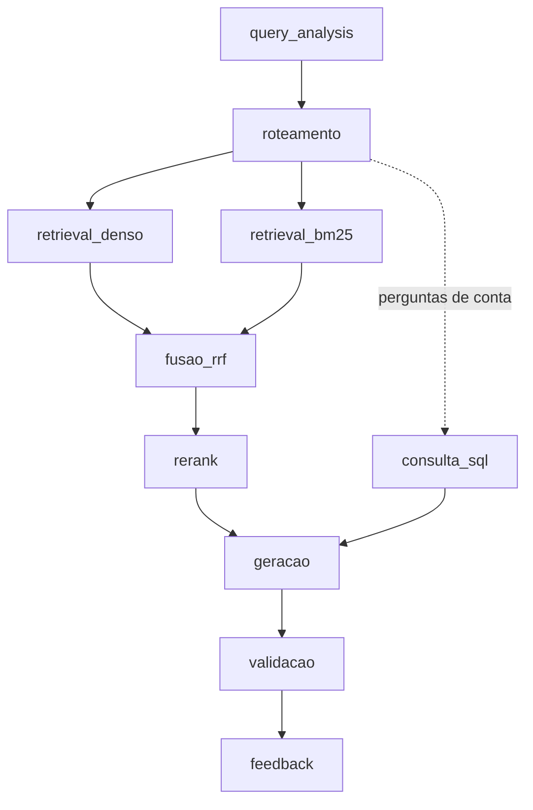

# RAG — Grande Desafio · Cenário 1: Contratações Públicas do RJ

**Residência TIC em Trilhas · PUC-Rio · Instituto ECOA**

Sistema de **Adaptive RAG** sobre contratações públicas do Estado do Rio de Janeiro: dado uma pergunta em linguagem natural, o sistema decide sozinho **onde buscar** (norma, registro estruturado, conversa ou número agregado) antes de buscar, recupera evidência híbrida (densa + BM25 + RRF + rerank) e gera uma resposta citando fontes — ou recusa, quando o caso exige.

O corpus **v7-reparo** (`v7-qwen-q8-2026-10-26`) reúne 106.667 registros em
`contratacoes`, 144.112 chunks e **144.112 vetores Qwen3-Embedding-0.6B.Q8_0**.
Os arquivos de dados são distribuídos separadamente do código:

**📁 [Baixar o pacote V7 no Google Drive](https://drive.google.com/drive/folders/14K1K-q9kze5qivG__b0KvkJV4L7buc1r?usp=drive_link)**

Consulte o [inventário](CORPUS_INVENTORY.md), o
[plano de correção](docs/PLANO_CORRECAO_SQL_PIPELINE_V7.md) e o
[fluxo de consulta](docs/CLI.md). Correções de consulta e limites sem alterar o
snapshot: [qualidade das respostas sem reindexação](docs/QUALIDADE_RESPOSTAS_SEM_REINDEXACAO.md).
O suplemento sintético conversacional (25 e-mails) também está ativo:
[docs/emails_sinteticos.md](docs/emails_sinteticos.md).

A v6 (1.400 arquivos) ficou como referência das medições de regressão; os
seus vetores continuam em `data/embeddings/2026-10-07_21-18-41_ocr-recovery/`.
Os dados da v7 (`documents.jsonl`, SQLite e `index/`, 5,3 GB) não vão para o
Git: cada integrante baixa na própria máquina (passo a passo na seção de
instalação). As credenciais ECOA continuam locais no `.env`. Os arquivos brutos são externos
ao Git; as fontes públicas constam nos metadados. As entregas das atas estão em
[PDF](atas-zip/atas_conversacional-v6.zip) e
[Markdown](atas-zip/atas_conversacional-v6-md.zip), com 40 documentos cada.
Embeddings e ZIP da v5 permanecem no disco, fora destes commits.

## Por que este cenário

Todo órgão público brasileiro publica suas contratações no [PNCP](https://pncp.gov.br) por força da Lei 14.133/2021, mas o portal só permite consulta contrato a contrato — não permite cruzar edital, contrato, ata de registro de preços e valores homologados numa única pergunta. Este projeto constrói essa camada de consulta.

Escolhemos o Cenário 1 por ser o **mais verificável** dos três disponíveis (qualquer resposta pode ser conferida diretamente no portal do PNCP) e por oferecer o melhor contraste entre busca esparsa e densa: número de contrato e CNPJ só aparecem com BM25; "compra de equipamento hospitalar" só aparece com embeddings.

Contexto completo do desafio, dos outros dois cenários e dos padrões de engenharia exigidos está em [GRANDE_DESAFIO_CENARIOS.md](GRANDE_DESAFIO_CENARIOS.md).

## As quatro naturezas de conhecimento

| Base | Natureza | Conteúdo | Fonte | Acesso |
| --- | --- | --- | --- | --- |
| `editais_normativo` | Normativa | Lei 14.133/2021, decretos estaduais, editais de licitação | Senado Federal, REDELOG-RJ, CGE-RJ, MPPI | PDF/HTML por URL |
| `contratos_estruturado` | Estruturada | Censo de 2025 do RJ: 106.666 chunks; na base SQL, 106.667 registros (58.245 publicações de compra, 31.908 empenhos, 15.644 contratos assinados e 870 outros instrumentos) | PNCP — API de consulta | REST paginado |
| `atas_conversacional` | Conversacional | Atas de registro de preços: 34.953 chunks (JSON de metadados e PDFs) | PNCP | REST (JSON) + PDF |
| `emails_sinteticos` | Conversacional | Suplemento: 25 conversas fictícias de compras públicas; 20 públicas e 5 restritas | Base sintética gerada pelo tutor | JSON local |
| `pca_agregado` | Agregada | Planejamento e resultado das compras: 911 chunks (itens homologados, contratações vinculadas e um PCA confirmado, da Secretaria de Saúde estadual) | PNCP | REST (JSON) |

Números da v7 (2026-10-19); a base normativa e a agregada são as mesmas da v6
(1.557 e 911 chunks). Detalhes em [CORPUS_INVENTORY.md](CORPUS_INVENTORY.md) e
em [docs/registro_execucao_v6.md](docs/registro_execucao_v6.md).

A definição declarativa de cada base — fonte, tipo de acesso, volume-alvo, campo de vigência, licença — vive em [corpus_manifest.yaml](corpus_manifest.yaml), que é a fonte única de verdade sobre o que entra no corpus. `data/raw/` nunca é versionado; qualquer pessoa reconstrói o corpus rodando o coletor contra o manifesto.

Só as bases com `escopo: oficial` no manifesto respondem perguntas; as marcadas como `experimental` ficam fora da busca (`ESCOPOS_CONSULTADOS` em [src/pipeline.py](src/pipeline.py)).

**Base agregada.** Quando a base traz o CSV do PCA (um item planejado por linha), a preparação calcula indicadores com [src/pca_indicators.py](src/pca_indicators.py): visão geral, e totais, participação e ranking por categoria, unidade responsável, classe de catálogo e mês. Cada indicador vira **um chunk** com os números já calculados, e assim o LLM cita valores prontos, em vez de tentar somar linhas. Na v6, com o limite por órgão, a base ficou com um único PCA confirmado; os 911 chunks são quase todos registros JSON (itens homologados e contratações vinculadas), com só 2 indicadores. Contas sobre esses registros (soma por fornecedor, ranking, mediana) passam pela etapa `consulta_sql`.

**Base conversacional.** A API de atas do PNCP ignora o filtro `uf`; o recorte do RJ é feito pelo CNPJ do órgão (`cnpjs` no manifesto, o mesmo do PCA). Para cada ata, o coletor baixa o JSON de metadados, a listagem `/arquivos` e cada PDF anunciado nela. Parte desses PDFs é escaneada, sem texto; com o Tesseract instalado, a preparação aplica OCR nessas páginas ([src/ocr.py](src/ocr.py)). Os chunks do PDF herdam da mesma ata a vigência (`dataVigenciaFim`) e o título do documento, que também aparecem para o LLM no cabeçalho de cada trecho — assim ele distingue a ata de uma publicação no Diário Oficial anexada a ela.

**Suplemento sintético conversacional.** `emails_sinteticos` participa das consultas
normais pela natureza conversacional. Apenas os 25 JSONs individuais do ZIP são
importados; as cópias TXT e o JSONL consolidado não duplicam a base. Cada conversa
preserva suas mensagens e classificação de sensibilidade. Cinco conversas com
credenciais/dados bancários são restritas e não chegam ao LLM; CPF, telefone e
e-mail pessoal das demais são mascarados. Texto e cabeçalho identificam o conteúdo
como **sintético**, que não pode comprovar fatos reais do PNCP. Reimportação e
proveniência em [docs/emails_sinteticos.md](docs/emails_sinteticos.md).

> A API do PNCP **não tem busca textual**. Filtro por objeto é feito localmente, e o recorte de dados é sempre determinístico (mesmo manifesto ⇒ mesmo corpus).

## Roteamento adaptativo — a ideia central

A pergunta que o roteador responde não é "sobre o que o usuário falou", e sim "que tipo de evidência responde isso". Três perguntas quase idênticas em vocabulário podem exigir três rotas distintas:

- *"Qual foi o valor médio por quilo de arroz contratado por municípios do RJ em 2025?"* → agregada + estruturada.
- *"Quais contratos de licenciamento de software foram assinados acima de R$ 500 mil em 2025?"* → estruturada, com filtro numérico extraído da pergunta.
- *"Sou MEI, posso participar de pregão eletrônico? Tem algum aberto pra material de escritório?"* → normativa (tratamento a ME/EPP) **e** estruturada (contratações em aberto) na mesma pergunta.

As seis personas de referência, com as 18 perguntas classificadas por rota esperada e tipo (mais uma pergunta de falha esperada), estão em [PERSONAS.md](PERSONAS.md) — e viraram o golden set que `eval/run_eval.py` roda contra o pipeline. `src/router.py` já implementa esse roteamento de forma determinística (regex sobre o texto normalizado da pergunta, sem chamar o LLM).

## Política de sensibilidade

Classificação feita na **ingestão** (metadado `sensitivity` em cada chunk), nunca delegada ao LLM na hora de responder:

- **Responder:** valores de contrato, nome de empresa fornecedora, CNPJ de pessoa jurídica, objeto contratado — público por lei.
- **Mascarar:** CPF de pessoa física contratada, telefone e e-mail pessoal de servidor que aparecem em atas.
- **Recusar:** dados bancários de fornecedor, credenciais vazadas em e-mail, juízo sobre a legalidade de um contrato específico (o sistema apresenta dados, não acusa). Ver `RefusalReason` em [src/schema.py](src/schema.py).

Como é aplicada ([src/sensitivity.py](src/sensitivity.py), chamado por [src/generate.py](src/generate.py)):

- **Mascaramento determinístico (regex), em dois pontos:** no contexto antes do prompt (o LLM nunca vê o dado) e na resposta final (caso o dado venha da própria pergunta). CPF formatado é sempre mascarado; CPF só com dígitos e telefone sem DDD entre parênteses/`+55` só quando rotulados (`CPF:`, `Tel.:`), para não mascarar ids de processo. E-mails de domínio institucional (`.gov.br`, `.jus.br`, `.mp.br`, `.leg.br`, `.def.br`, `.mil.br`) são preservados; os demais viram `[e-mail omitido]`. CNPJ não é tocado.
- **Chunks `sensitivity=restrito` são descartados** antes da geração; se só sobrarem restritos, a resposta é recusa `sem_evidencia`.
- O log de geração registra quantos dados foram mascarados por tipo (`mascaramentos`) e quantos chunks restritos foram descartados — nunca o valor original.
- Testes em [tests/test_sensitivity.py](tests/test_sensitivity.py).

## Pipeline



O diagrama mostra os caminhos possíveis: em uma pergunta puramente analítica,
SQL suficiente dispensa recuperação e reranker. A LLM faz uma única chamada
para escrever uma apresentação neutra com `{{sql}}`; o backend substitui o marcador
pelo resultado determinístico completo, com fontes, sem enviar os números à LLM.
Template inválido ou falha do provedor preserva a resposta SQL direta como fallback.
Resultados tabulares são Markdown GFM gerado pelo código, renderizado como tabela
no frontend e preservado por inteiro nos logs (`resultado_markdown` no SQL e
`resultado_sql_markdown` na geração). O histórico guarda o mesmo `answer` Markdown.
Se o cálculo falhar ou for insuficiente, a busca permanece como fallback;
perguntas mistas preservam as evidências das outras bases e a geração normal.

Estágios de consulta (nomes fixos no campo `stage`): `interacao`, `reformulacao`, `query_analysis`, `roteamento`, `retrieval_denso`, `retrieval_bm25`, `fusao_rrf`, `rerank`, `consulta_sql`, `geracao`, `validacao`, `feedback` e `resumo_consulta`. Envelopes: `pipeline_inicio`, `pipeline_fim`, `requisicao_inicio`, `requisicao_fim` e `persistencia_historico`. Operações offline usam `coleta`, `inventario`, `ingestao`, `preparacao`, `embeddings`, `indexacao` e `embedding_lote`, no mesmo JSONL. Detalhes de decisão e divisão de responsabilidades em [ARQUITETURA.md](ARQUITETURA.md); contrato dos logs em [docs/OBSERVABILIDADE.md](docs/OBSERVABILIDADE.md).

**Implementado:**

- `query_analysis` ([src/query_analysis.py](src/query_analysis.py)): extrai da pergunta, sem LLM, filtros de ano, valor (mínimo, máximo, faixa) e órgão.
- `roteamento` ([src/router.py](src/router.py)): escolhe as bases antes de buscar.
- `retrieval_denso` / `retrieval_bm25` / `fusao_rrf` ([src/retrieve.py](src/retrieve.py)): busca híbrida com filtros de metadado. Os filtros são aplicados base a base: numa base sem o campo filtrado, ou em que o filtro excluiria todos os chunks, ele é ignorado e o log registra isso em `extra.filtros_ignorados`. Se ainda assim os filtros zerarem o resultado, [src/pipeline.py](src/pipeline.py) refaz a busca sem eles. As partes da busca ficam em [src/retrieval/](src/retrieval/), e `retrieve.py` é a entrada. Depois da fusão, no máximo `RETRIEVAL_MAX_PER_PURCHASE` trechos por compra (padrão 2; `0` desliga) ficam à frente, e os demais vão para o fim da lista, sem serem descartados: nas atas, uma compra tem muitas páginas e podia ocupar o topo inteiro. A regra não vale quando a pergunta cita um número do PNCP ou de contrato. Nas 9 perguntas de ata do conjunto de busca, as compras distintas no top 10 passaram de 4,67 para 6,44.
- `rerank` ([src/rerank.py](src/rerank.py)): um cross-encoder local (`RERANK_MODEL`, padrão `cross-encoder/mmarco-mMiniLMv2-L12-H384-v1`, roda em CPU) reordena os `RERANK_CANDIDATES` (padrão 10) primeiros do RRF. Chunks JSON vão para o modelo com os campos de conteúdo primeiro (`objetoCompra`, título, órgão...), porque o modelo só lê 512 tokens. Se o modelo falhar, o log registra erro e o resultado volta a ser o do RRF. O `retrieve` aplica o reranker que receber; `reranker_padrao()` devolve o cross-encoder, ou `None` com `RERANK_ENABLED=false`. O `responder` ([src/pipeline.py](src/pipeline.py)) usa o `reranker_padrao()` quando nenhum reranker é passado. Na ablação no corpus v6 (47 perguntas rotuladas, 13 delas de identificador como CNPJ e número de contrato), o hit@3 sobe de 0,64 (só RRF) para 0,83 com o rerank, a melhor configuração medida; o denso sozinho não acha identificadores (0,31) e o BM25 sozinho erra as perguntas parafraseadas: ver [docs/ABLACAO_RERANK.md](docs/ABLACAO_RERANK.md). Na primeira execução o modelo (~470 MB) é baixado para o cache do Hugging Face.
- `consulta_sql` ([src/structured_query.py](src/structured_query.py) + [src/structured_db.py](src/structured_db.py)): perguntas de conta sobre as bases estruturada e agregada (ranking, estatística com média e mediana, comparação entre esferas, evolução no tempo, agrupamento) são respondidas por uma consulta SQL pré-escrita e parametrizada — o LLM nunca escreve SQL. O resultado entra como chunk (`doc_type="sql"`, `chunk_id` começando com `sql:`) antes dos chunks da busca. Perguntas exclusivamente analíticas tentam SQL primeiro: com cálculo suficiente, pulam busca densa/BM25/RRF/rerank. A LLM escreve somente um template com `{{sql}}`, e o backend injeta os resultados completos depois, sem reescrita dos números pela LLM. O marcador precisa aparecer uma única vez, em linha própria; marcadores extras, números/citações na narrativa ou falha do modelo acionam fallback determinístico (`sql_template_fallback` no log). A validação do template é sintática, não prova semântica de toda a narrativa. Perguntas mistas mantêm a recuperação e a geração normal. Totais incluem zeros/centavos registrados, enquanto média/mediana e extremos informativos são qualificados para valores >= R$ 1,00. Validação real CLI/frontend e valores conferidos no bruto em [docs/NUMERICAL_VALIDATION.md](docs/NUMERICAL_VALIDATION.md). Se o termo pedido não existe no objeto de nenhuma contratação, o resultado diz isso em vez de calcular sobre outro assunto. Falha no banco é registrada no log e a resposta segue só com a busca.
- `interacao` ([src/conversation.py](src/conversation.py)) e `reformulacao` ([src/reformulation.py](src/reformulation.py)):
  - **Interação:** a mensagem com rota já reconhecida não passa pelo LLM de intenção. Nas 36 perguntas do golden set, a etapa caiu de 62,8 s para 0 s.
  - **Reformulação:** as continuações de troca de ano, de lugar e de esfera ("E em 2025?", "E em Niterói?", "E só os da esfera federal?") são resolvidas por regras, sem LLM. As pistas de continuação se dividem em fortes ("desses", "os mesmos") e fracas ("em 2025").
  - **LLM da reformulação:** o restante vai ao LLM com `max_tokens` de 4.096 e prazo próprio (`REFORMULACAO_TIMEOUT`, padrão 60 s), que corta o tempo de fato. Se o prazo estourar, a pergunta segue com a anterior anexada (plano B).
- `geracao` ([src/generate.py](src/generate.py) e as partes em [src/generation/](src/generation/)): guardrails determinísticos antes do LLM, prompt limitado à janela do modelo (`GENERATION_CONTEXT_CHARS` no total e `GENERATION_CHUNK_CHARS` por chunk; o log registra `chunks_no_prompt` e `chunks_fora_do_orcamento`) e saída pedida em JSON (`response_format`).
- `validacao` ([src/generate.py](src/generate.py)): checa a saída do LLM. no caminho normal, JSON inválido vira recusa segura (no template SQL, preserva o resultado calculado como fallback); citação de chunk que não foi recuperado é descartada (`extra.citacoes_descartadas`) e dado pessoal na resposta é mascarado. As regras de citação ficam em [src/generation/citations.py](src/generation/citations.py):
  - a menção a um trecho no texto ("o registro E1", "em E3") vira fonte numerada;
  - a resposta sem nenhuma fonte pede a citação ao LLM uma vez;
  - a recusa indevida, que só reconhece evidência insuficiente, volta a ser resposta.

  O prompt do sistema, em `generate.py`, pede que a resposta que conclui pela ausência de dados cite os trechos examinados.

[src/pipeline.py](src/pipeline.py) une as etapas numa única função (`responder`).

`feedback` ([src/history_store.py](src/history_store.py)): toda chamada a `POST /api/v1/query` recebe um `query_id` e é salva (pergunta + resposta completa) num SQLite local (`data/app_state/historico.sqlite`, fora do Git — diferente da base derivada de `structured_db.py`, este é estado da aplicação e não é remontado). `POST /api/v1/feedback` associa uma avaliação (`positivo`/`negativo` + comentário opcional) a um `query_id` já registrado (404 se não existir) e grava o evento no log estruturado com `stage="feedback"`. `GET /api/v1/history?limit=N` devolve as consultas mais recentes com o feedback recebido. O acesso tem dois personas: quem envia `X-API-Key` igual a `RAG_API_KEY` (quem opera a demo) vê o histórico inteiro e pode filtrar por `&session_id=...`; o dono da conversa se identifica pelo header `X-Session-Id` e vê só as consultas dela. Sem nenhuma das duas credenciais, `401` sem revelar o que existe no log. O `session_id` de query param é filtro do operador, não autenticação. O trace usa a mesma autorização: `X-API-Key` ou o header `X-Session-Id` da própria conversa, para o usuário ver o caminho das suas perguntas sem chave no site; o histórico grava os textos mascarados e apaga consultas com mais de `HISTORY_RETENTION_DAYS` dias (padrão 30). Testes em [tests/test_history_store.py](tests/test_history_store.py) e [tests/test_app_api.py](tests/test_app_api.py).

O parsing da geração aceita as variações de chave que o modelo da turma produz na prática (`sources` em vez de `sources_used`, `confidence` numérico em vez de `confidence_level`) e registra no log, em `extra.chaves_fora_do_contrato`, quando isso acontece. Toda etapa registra log estruturado via [src/obs.py](src/obs.py) (JSONL em `logs/pipeline/pipeline-AAAA-MM-DD.jsonl`, com `run_id`, `stage`, latência e tokens). A retenção acompanha `HISTORY_RETENTION_DAYS` por padrão (30 dias); `LOG_RETENTION_DAYS=0` desliga o expurgo. Diagnósticos ficam em `logs/maintenance/`, backups em `data/backups/` e temporários de testes em `.tmp/tests/`. `python -m src.log_maintenance cleanup` mostra o plano de expurgo; somente `--apply` o executa. Diagnósticos concluídos e testes falhos seguem `MAINTENANCE_RETENTION_DAYS` (14 dias); backups nunca são expurgados automaticamente.

Cada chamada a `responder` abre `pipeline_inicio` e fecha `pipeline_fim`, mesmo quando há exceção. A API envolve esse caminho em `requisicao_inicio`/`requisicao_fim` e registra `persistencia_historico`, com HTTP status e `history_saved`. Os stages internos continuam correlacionados por `run_id`, `query_id` e `session_id`; etapas não executadas ficam explícitas como `pulado`, e fallbacks tratados como `degradado`. `extra.schema_version=2` identifica origem, sequência, resultado normalizado e tentativas/intenção. Os envelopes trazem fingerprints de código/índice e configuração permitida; SQL registra tentativas e parâmetros mascarados; a geração registra prompt, evidências e resposta. `resumo_consulta` distingue consulta tentada de evidência retornada.

Coleta, preparação, embeddings e indexação também emitem o contrato comum, com `origem=offline` e IDs de correlação próprios. A coleta preserva o log legado em `data/runs/`; relatórios e artefatos existentes não mudam. `extra.uso_tokens` distingue uso reportado, parcial, estimado, desconhecido, cache e ausência de chamada; quando o provedor não informa o uso (como o OpenRouter gratuito), os tokens são estimados pelo tamanho do texto, com cerca de 4 caracteres por token, e marcados como `estimado`. `chamadas_modelo` observa chamadas SDK e fallbacks; retries HTTP internos ficam explicitamente não observados, sem inventar consumo. `interacao` e `reformulacao` registram o modelo efetivo. O subdiretório `logs/pipeline/` foi mantido por decisão do projeto, apesar do caminho de raiz exemplificado no enunciado.

A escrita usa fila limitada e lotes, coordenados entre processos por SQLite/WAL local; JSONL continua sendo a fonte de verdade. Um índice derivado (`logs/pipeline/pipeline-index.sqlite`) permite consultar traces sem reler todo o conteúdo dos logs; importação legada é incremental. `LOG_EVIDENCE_DETAIL=resumo` é o padrão; `completo` acrescenta todas as evidências retornadas, resultados SQL e prompt mascarados, sem aumentar o contexto do LLM.

`GET /api/v1/trace/{query_id}` e `GET /api/v1/sessions/{session_id}/trace` continuam compatíveis com logs antigos. O tempo total vem do envelope monotônico, não da soma de etapas sobrepostas; traces novos indicam `completo`, `status` e `latencia_metodo`. Feedback posterior não aumenta a duração da consulta. Textos têm limites explícitos e dados pessoais são mascarados também em `extra`. Falha de I/O no logger não derruba a resposta. Testes isolam tanto logs quanto histórico da API ([tests/conftest.py](tests/conftest.py)), sem escrever em dados reais. Contrato, exemplos e limites em [docs/OBSERVABILIDADE.md](docs/OBSERVABILIDADE.md) e [docs/FRONTEND_API_CONTRACT.md](docs/FRONTEND_API_CONTRACT.md).

## Estrutura do repositório

[Reparo incremental V7](docs/REPARO_V7.md): reutilização dos módulos existentes,
SQLite compatível, cobertura vetorial, validação e rollback.

```
├── docs/                         ← guia da interface CLI e capturas de tela
├── CORPUS_INVENTORY.md           ← inventário legível do corpus coletado
├── data/
│   ├── raw/vN/                  ← versão imutável de cada coleta (staging em raw/.staging/ até promoção)
│   ├── normalized/              ← chunks normalizados (JSONL), saída de src/prepare_documents.py (fora do Git: baixar a v7 do Drive)
│   ├── embeddings/               ← embeddings versionados (cache + partes), gerados por src/create_embeddings.py
│   ├── inventory/                ← inventário por versão (JSON), checkpoints e diffs entre versões
│   ├── runs/                    ← relatórios de execução de cada coleta
│   └── attempts/                ← coletas e preparações experimentais (--data-root), fora do Git
├── index/                       ← índice vetorial por base (vectors.jsonl + vectors.faiss); fora do Git: baixar a v7 do Drive
├── logs/                        ← pipeline/ (JSONL diário) e maintenance/ (diagnósticos), fora do Git
├── eval/                        ← golden set das personas e harness de avaliação (run_eval.py)
├── tests/fixtures/               ← amostras locais para testes offline
├── tests/                       ← testes de contrato (pytest), offline
├── app/
│   ├── cli.py                   ← interface de linha de comando: rota e resposta completa do pipeline
│   ├── api.py                   ← API HTTP (FastAPI): /health, /ready, /api/v1/query, /api/v1/feedback, /api/v1/history, /api/v1/trace
│   └── rate_limit.py            ← limite de requisições por cliente (IP real atrás do túnel), 429 com Retry-After
├── src/
│   ├── fetch_corpus.py          ← coleta determinística e versionada do corpus
│   ├── providers/               ← provedores declarativos de fontes (pncp.py: contratações, atas + PDFs, PCA)
│   ├── pncp_client.py           ← cliente HTTP do PNCP com tentativas e timeout
│   ├── artifact_downloader.py   ← download de arquivos (PDF/HTML/CSV) com detecção de formato e deduplicação por SHA-256
│   ├── retry.py                 ← espera entre tentativas HTTP (Retry-After do servidor ou backoff exponencial)
│   ├── ssl_context.py           ← certificados HTTPS: os do sistema somados ao bundle do certifi
│   ├── corpus_validator.py      ← validação do inventário contra o manifesto
│   ├── source_catalog.py        ← curadoria das fontes (subcomandos discover, lookup, propose)
│   ├── manifest_curator.py      ← descoberta e propostas para o manifesto
│   ├── source_lookup.py         ← busca remota nas fontes suportadas
│   ├── corpus_search.py         ← busca local no inventário
│   ├── ingest.py                ← fachada compatível; delega a extração para prepare_documents.py
│   ├── prepare_documents.py     ← extração por formato (PDF/HTML/CSV/JSON/JSONL), chunking e metadados canônicos
│   ├── pca_indicators.py        ← indicadores agregados do PCA (1 indicador = 1 chunk) para a base agregada
│   ├── ocr.py                   ← OCR (Tesseract) das páginas de PDF escaneadas, usado por prepare_documents.py
│   ├── corpus_quality.py        ← controle de qualidade do normalizado: texto ilegível, vigência das normas, contrato↔compra, valor simbólico
│   ├── create_embeddings.py     ← embeddings com cache, multi-provedor e escrita incremental
│   ├── index.py                 ← índice vetorial por base; gera embeddings ou reaproveita os de data/embeddings/
│   ├── query_analysis.py        ← extrai filtros de ano, valor e órgão da pergunta (entrada; análise por LLM)
│   ├── analysis/                ← entities.py (órgão, município, fornecedor e CNPJ citados, pelo catálogo do corpus) e suppliers.py (fornecedor pela raiz do CNPJ e pela razão social)
│   ├── conversation.py          ← etapa interacao: conversa, pedido de ajuda, injeção e role-play com resposta fixa, sem LLM
│   ├── reformulation.py         ← etapa reformulacao: continuações ("E em 2025?") por regras ou pelo LLM, com prazo próprio
│   ├── structured_db.py         ← base estruturada em SQL (Postgres/Neon ou SQLite): tabelas contratacoes e pca_planos
│   ├── structured_query.py      ← consultas SQL fixas (ranking, estatística, evolução, agrupamento) como evidência (entrada)
│   ├── sql_query/               ← detection.py (que conta a pergunta pede) e execution.py (WHERE e um executor por tipo)
│   ├── router.py                ← roteamento determinístico (Adaptive RAG)
│   ├── retrieve.py              ← entrada da recuperação híbrida (denso + BM25 + RRF + rerank plugável); reexporta os nomes das partes
│   ├── retrieval/               ← partes da busca: filters, lexical, ranking (inclui a variedade por compra), records, identifiers, norms, evidence
│   ├── lexical_index.py         ← índice invertido da BM25 (arrays numpy), com o mesmo ranking da varredura
│   ├── rerank.py                ← rerank por cross-encoder local sobre os candidatos do RRF
│   ├── generate.py              ← entrada da geração: cliente LLM, prompt do sistema, gerar_resposta e validação; reexporta os nomes das partes
│   ├── generation/              ← partes da geração: guardrails, context, notices, responses, sql_answer, parsing, generation_log, citations
│   ├── sensitivity.py           ← política de sensibilidade: mascaramento de CPF/telefone/e-mail e filtro de restritos
│   ├── pipeline.py              ← caso de uso: une query_analysis + roteamento + recuperação + geração (responder)
│   ├── ports.py                 ← contratos (Protocol) que o pipeline espera da busca, do SQL, do LLM e do roteador
│   ├── domain/                  ← regras de negócio puras: confiança, situação da compra, RRF, normalização (ver ARQUITETURA)
│   ├── history_store.py         ← histórico de consultas e feedback do usuário (SQLite local, data/app_state/)
│   ├── obs.py                   ← logging estruturado (JSONL) e contagem de tokens
│   ├── log_store.py             ← fila, append coordenado e índice SQLite/WAL de traces
│   ├── log_chain.py             ← cadeia de hashes do log JSONL e o verificador (python -m src.log_chain verificar)
│   ├── log_evidence.py          ← auditoria completa opcional de evidências mascaradas
│   ├── offline_observation.py   ← contrato JSONL e correlação para operações offline
│   ├── model_observation.py     ← chamadas SDK, uso disponível e cobertura de tentativas
│   ├── trace.py                 ← caminho de uma pergunta ou de uma sessão, montado a partir do log
│   ├── snapshot.py              ← validação do pacote de dados (runtime_bundle.json) usada pelo /ready
│   └── schema.py                ← modelos Pydantic (chunk, roteamento, resposta, recusa)
├── llm_ecoa.py                  ← exemplo mínimo de geração e embedding via endpoint compartilhado
├── corpus_manifest.yaml         ← o que entra no corpus (fonte única de verdade)
├── ARQUITETURA.md               ← pipeline, estágios e divisão de responsabilidades
├── PERSONAS.md                  ← personas e perguntas de referência
└── .env.example                 ← variáveis necessárias, sem valores reais
```

**Organização do código (2026-10-26 a 2026-10-28).** O caminho da pergunta segue
camadas, com a dependência apontando para dentro:
- **domínio:** regras puras em `src/domain/`;
- **portas:** contratos em `src/ports.py`;
- **caso de uso:** `src/pipeline.py`, que recebe as implementações por injeção;
- **adaptadores:** `src/retrieval/`, `src/generation/`, `src/sql_query/` e `src/analysis/`.

O [tests/test_architecture.py](tests/test_architecture.py) falha se o domínio
importar infraestrutura ou se uma parte importar a sua entrada. Nenhuma função
de `src/` passa de 100 linhas.

Os arquivos de `src/` com nome em português foram renomeados para inglês (por
exemplo, `coletar_direto.py` → `direct_collection.py` e `qualidade_corpus.py` →
`corpus_quality.py`). O nome antigo continua importável e executável
(`python -m src.coletar_direto` funciona), e o teste de arquitetura confere cada
um. Detalhes em [ARQUITETURA.md](ARQUITETURA.md).

## Como rodar

O guia visual da interface de coleta, curadoria e busca está em
[docs/README.md](docs/README.md), com exemplos de comandos e capturas de tela
da CLI.

**0. Em um comando** (depois de clonar)

```powershell
powershell -ExecutionPolicy Bypass -File scripts\setup.ps1   # Windows
# ou: bash scripts/setup.sh                                  # Linux/macOS
```

O script cria o `.venv`, instala o `requirements-lock.txt`, copia
`.env.example` para `.env` (quando falta) e confere os artefatos versionados.

**Dados V7:** baixe o ZIP com FTS e seu `.sha256` na
[pasta do Google Drive](https://drive.google.com/drive/folders/14K1K-q9kze5qivG__b0KvkJV4L7buc1r?usp=drive_link)
e extraia o ZIP **na raiz do backend**. Os arquivos grandes ficam fora do Git e já
estão organizados nos caminhos usados pela aplicação:

```
├── data/normalized/documents.jsonl
├── data/structured/base_estruturada.sqlite
├── data/config/orgaos_corpus.json
├── index/
└── runtime_bundle.json
```

Configure no `.env`:

```dotenv
SNAPSHOT_MANIFEST=runtime_bundle.json
```

Inicie ou reinicie a API e confira `/ready`. Não distribua o `.env` local.

O `/ready` confere o pacote inteiro: os hashes dos arquivos, a versão do
esquema SQL, a cobertura do índice e o catálogo. A primeira validação depois de
subir leva **cerca de 2 minutos**. Enquanto ela roda, outras chamadas recebem na
hora 503 com `validacao_em_andamento`, em vez de começar outra leitura. Depois,
o resultado fica guardado enquanto nenhum arquivo do pacote mudar de tamanho ou
de data, e as chamadas respondem em milissegundos.

Desde 2026-10-27, só uma validação roda por vez. Antes, cada chamada repetia a
validação inteira (cerca de 55 s de CPU), e chamadas seguidas chegaram a travar
o backend. Para esperar a API ficar pronta, chame o `/ready` a cada 10 s, sem
disparar várias chamadas ao mesmo tempo.
Checksum do pacote, validação e rollback em
[docs/REPARO_V7.md](docs/REPARO_V7.md).

O índice do objeto no SQL (`python -m src.structured_db fts`, ≈5 s, +60 MB)
acelera as contas por objeto ("contratos de ambulância") sem mudar o resultado;
sem ele, o SQL continua funcionando, só mais devagar. Como o comando altera
`base_estruturada.sqlite` e o `runtime_bundle.json` confere o hash desse
arquivo, o pacote com FTS já inclui o índice e o manifesto atualizado;
não é necessário executar esse comando após a extração. Consulte o checksum
em [docs/REPARO_V7.md](docs/REPARO_V7.md). Alterar o banco sem atualizar o
manifesto faz o `/ready` responder 503 (`hash_divergente`).

Ou, sem o Drive, reconstrua do manifesto (lento, ~2h+):
```bash
python -m src.fetch_corpus fetch --manifest corpus_manifest.yaml
python -m src.structured_db build
```

Depois de ter os dados:

```powershell
.venv\Scripts\python -m uvicorn app.api:app --host 127.0.0.1 --port 8080
```

Com a v7, a API leva cerca de 1 minuto para subir e mais cerca de 2 minutos para
a primeira validação do `/ready`. Ela lê os índices e prepara o BM25 em segundo
plano (`INDEX_PRELOAD`).

A memória caiu em 2026-10-26 e 2026-10-27, com o mesmo resultado nas buscas:
- O BM25 passou a usar um índice invertido (`src/lexical_index.py`), que ocupa
  ~185 MB no lugar dos ~1,4 GB das contagens por trecho.
- Os metadados do índice passaram a ser lidos do próprio documento, sem uma
  segunda cópia (−925 MB).
- A pré-carga caiu de 5,1 GB para 4,2 GB, e o pico com o backend no ar ficou em
  ~4,4 GB numa máquina de 16 GB (antes, ~6 GB depois de responder pelo LLM).

Nas 47 buscas do conjunto de avaliação, o tempo total caiu de 179 s para cerca de
40 s, com a mediana de 0,22 s por busca. Feche o que não for necessário antes da
demonstração e faça uma pergunta de aquecimento.
O golden set roda o pipeline no próprio processo e carrega a v7 de novo:
desligue o backend antes de rodá-lo, para os dois não disputarem a memória.

Modelos externos (reranker ~470 MB + GGUF do Qwen3-Embedding 639 MB, só para
o modo local de embeddings) têm download em um comando com URL oficial e
SHA-256 verificado:

```powershell
powershell -ExecutionPolicy Bypass -File scripts\models.ps1
# ou: bash scripts/models.sh
```

**1. Configurar ambiente**

```bash
python -m venv .venv
.venv\Scripts\activate          # Windows
pip install -r requirements-lock.txt
copy .env.example .env          # preencher se necessário; os defaults já apontam para o endpoint da turma
```

O [requirements-lock.txt](requirements-lock.txt) fixa a versão exata de cada pacote, a mesma usada no CI, e instala o torch só de CPU. O [requirements.txt](requirements.txt) continua com as faixas de versão aceitas: ao mudá-lo, gere o lock de novo com o comando do cabeçalho do lock.

Opcional: para ler as atas escaneadas, instale o Tesseract com o idioma português (passo a passo em [docs/CLI.md](docs/CLI.md#ocr-de-pdfs-escaneados-opcional)). Sem ele, tudo funciona, mas as páginas escaneadas ficam sem texto.

No Windows, coletas em pastas com nome longo podem passar do limite de 260 caracteres de caminho (`FileNotFoundError: [WinError 3]`). Ative o suporte a caminhos longos, no PowerShell como administrador:

```powershell
Set-ItemProperty 'HKLM:\SYSTEM\CurrentControlSet\Control\FileSystem' -Name LongPathsEnabled -Value 1
```

**2. Coletar o corpus** (materializa versões imutáveis a partir do manifesto)

```bash
py -m src.fetch_corpus fetch --manifest corpus_manifest.yaml --official
py -m src.fetch_corpus update --manifest corpus_manifest.yaml --official
py -m src.fetch_corpus inventory --corpus-version v2 --official
```

**Curar novas fontes antes da coleta**

`source_catalog` pode descobrir fontes e gerar propostas sem alterar o
manifesto. A incorporação oficial exige revisão e `apply`, que valida o hash
do manifesto antes de escrever:

```bash
py -m src.source_catalog discover
py -m src.source_catalog lookup pncp --query "contratação software" --uf RJ --year 2025
py -m src.source_catalog propose --manifest corpus_manifest.yaml
py -m src.source_catalog manifest-diff --manifest corpus_manifest.yaml --proposal data/proposals/manifest-proposal-AAAA.json
py -m src.source_catalog review --proposal data/proposals/manifest-proposal-AAAA.json
py -m src.source_catalog apply --manifest corpus_manifest.yaml --proposal data/proposals/manifest-proposal-AAAA-reviewed.json
```

O comando `apply` é o único dessa interface que altera o manifesto. Depois da
revisão, use `fetch` ou `update` para materializar a definição aprovada.

`lookup` pesquisa uma fonte remota suportada, mas não incorpora resultados ao
corpus automaticamente. Para pesquisar o que já foi coletado, use o inventário:

```bash
py -m src.corpus_search search local \
  --corpus-version v1 \
  --query "edital 90012" \
  --base-id documentos_pncp
```

Essa busca inicial consulta apenas metadados (`logical_id`, base, origem,
caminho, tipo e hash); ela não faz busca textual dentro de PDFs.

Para inspecionar um update sem rede nem escrita:

```bash
py -m src.fetch_corpus update --manifest corpus_manifest.yaml --official --dry-run
```

Use `--official` somente para operar a árvore principal `data/`. Sem essa
flag, a execução é experimental e exige um `--data-root` separado. Cada
tentativa terá seu próprio `raw/`, `inventory/`, `runs/` e
`CORPUS_INVENTORY.md`:

```bash
py -m src.fetch_corpus fetch --manifest corpus_manifest.yaml --data-root data/attempts/corpus_fetch/tentativa-v5
py -m src.fetch_corpus update --manifest corpus_manifest.yaml --data-root data/attempts/corpus_fetch/tentativa-v5
py -m src.fetch_corpus inventory --corpus-version v1 --data-root data/attempts/corpus_fetch/tentativa-v5
```

O diretório `data/attempts/` é experimental e fica fora do Git; ele não
substitui as versões oficiais em `data/raw/` e `data/inventory/`.

Para uma verificação rápida após clonar o repositório, há 20 PDFs pequenos em
`tests/fixtures/pdf/`. A base `exemplos_teste` está declarada no manifesto
principal e pode ser executada em uma área experimental:

```bash
py -m src.fetch_corpus fetch `
  --manifest corpus_manifest.yaml `
  --data-root data/attempts/corpus_fetch/demo `
  --base-id exemplos_teste

pytest tests/ -m "not llm"
pytest tests/test_fetch_corpus.py -q
```

Os PDFs são amostras de entrada para inspeção e testes locais. A base usa
`arquivo_local`, não faz requisições externas e só entra no corpus quando o
comando é executado; usando `--data-root`, a execução não altera `data/raw/`.

**3. Preparar documentos e PDFs** (extrai formatos, organiza metadados e grava chunks JSONL)

```bash
py -m src.prepare_documents `
  --input tests/fixtures/pdf `
  --manifest corpus_manifest.yaml `
  --base-id exemplos_teste `
  --output data/attempts/corpus_fetch/demo/normalized/documents.jsonl `
  --report data/attempts/corpus_fetch/demo/normalized/extraction_report.json

py -m src.prepare_documents `
  --input tests/fixtures/pdf `
  --manifest corpus_manifest.yaml `
  --base-id exemplos_teste `
  --dry-run
```

Para preparar uma base de uma coleta já registrada, informe o inventário
correspondente. O preparador usa `base_id + SHA-256` para recuperar a origem e o
horário real de coleta de cada arquivo, e usa a `source_ref` do inventário para
que o PDF de uma ata herde a vigência e o título do documento registrados nos
JSONs da mesma ata. Para sempre usar a versão completa mais recente, informe
`--latest` e o `--base-id`; nesse modo, o inventário é selecionado
automaticamente:

```bash
py -m src.prepare_documents `
  --latest `
  --base-id contratos_estruturado `
  --manifest corpus_manifest.yaml
```

A saída fica em `data/normalized/vN/contratos_estruturado/`, onde `vN`
corresponde à versão indicada no resumo e no relatório da execução. Para
reproduzir uma versão histórica, informe manualmente o inventário e os arquivos
brutos dessa mesma versão.

O script separado trata PDF, HTML, TXT, Markdown, CSV, JSON e JSONL. O
chunking é adaptativo conforme `chunking_sugerido` do manifesto: registros
estruturados permanecem inteiros, enquanto documentos normativos são divididos
por cláusulas/artigos quando esses cabeçalhos existem, usando o chunking
genérico como fallback. Cada chunk preserva `source_file`, `chunk_id`,
`parent_chunk_id`, `base_id`, `natureza`, `doc_type` (formato original), `sensitivity`,
SHA-256, página, vigência e proveniência no manifesto. Páginas de PDF sem texto
passam por OCR quando o Tesseract está instalado (`status_extracao: ok_ocr` no
relatório; sem OCR, `sem_texto`). `src/ingest.py` mantém uma fachada compatível
para esse mesmo fluxo oficial.

A base opcional `licitacoes_siga_csv` usa o CSV público da SEPLAG-RJ. O parser
detecta o delimitador publicado, preserva os nomes reais das colunas e cria um
chunk por licitação. A amostra versionada em `tests/fixtures/formats/` contém
50 linhas reais para testes rápidos; a URL do manifesto permite reconstruir o
arquivo completo.

**4. Criar embeddings com cache**

Primeiro valide sem chamar o endpoint:

```bash
py -m src.create_embeddings `
  --input data/attempts/corpus_fetch/demo/normalized/documents.jsonl `
  --output data/attempts/corpus_fetch/demo/embeddings/embeddings.jsonl `
  --dry-run
```

Com o endpoint configurado, remova `--dry-run`. O padrão usa lotes de 64,
pausa de 10 segundos entre chamadas e partes de até 45 MiB, seguindo a mesma
estratégia de persistência incremental da inspiração:

```bash
py -m src.create_embeddings `
  --input data/attempts/corpus_fetch/demo/normalized/documents.jsonl `
  --output data/attempts/corpus_fetch/demo/embeddings/embeddings.jsonl
```

O cache é indexado pelo SHA-256 do conteúdo e por uma impressão digital dos
metadados semânticos do chunk. Textos idênticos podem ser reutilizados quando
pertencem ao mesmo contexto; alterações em `base_id`, natureza, origem,
manifesto, vigência ou sensibilidade invalidam o embedding anterior. A
execução deixa, no mesmo diretório, `embeddings.part-0001.jsonl` (partes
atômicas) e `embedding_report.json` (estatísticas). Se o processo for
interrompido, a execução seguinte reutiliza somente registros compatíveis.

O diretório `data/embeddings/` fica versionável, como na inspiração. A
materialização pública atual está em
[`data/embeddings/embeddings.jsonl`](data/embeddings/embeddings.jsonl), com o
relatório em [`data/embeddings/embedding_report.json`](data/embeddings/embedding_report.json).
Assim, o professor pode testar a leitura e a indexação diretamente após clonar
o repositório. Novas execuções de desenvolvimento devem usar
`data/attempts/`, que continua fora do Git.

As opções de provedor são `ecoa`, `ollama`, `openai` e `custom`. O cache registra
provedor, endpoint e modelo para impedir a mistura de espaços vetoriais
diferentes.

Antes do índice, `src/corpus_quality.py` faz o controle de qualidade dos
JSONL de `data/normalized/` (o da raiz, o combinado da v6 e os da v6 por base).
Ele não muda o texto dos chunks, só status e metadados, então os vetores
continuam valendo:

- chunk de PDF sem mapa de caracteres (`/12 /3 □` ou `/U0044/U0049`) recebe
  `status_extracao: "texto_ilegivel"` e fica fora do índice;
- as normas recebem número, publicação e início da vigência
  (`extras.data_vigencia_inicio`), declarados no manifesto em
  `metadados_por_url`; editais e termos de referência do PNCP recebem a data de
  publicação da compra vinculada;
- o contrato herda a modalidade da compra da mesma contratação
  (`numero_controle_compra`), e a compra, o fornecedor do contrato;
- valor abaixo de R$ 1,00 recebe `extras.valor_simbolico: true`.

O relatório fica em [`data/inventory/qualidade_v6.json`](data/inventory/qualidade_v6.json).

```bash
py -m src.corpus_quality --verificar   # só conta, sem gravar
py -m src.corpus_quality               # aplica e grava o relatório
```

`src/index.py` monta o índice usado pela busca: particiona por `base_id`, grava
os metadados/vetores em `vectors.jsonl` e persiste um índice FAISS em
`vectors.faiss` para a recuperação densa. Depois de atualizar os documentos ou
o modelo de embeddings, rode esse comando novamente para reconstruir os
índices. `src.create_embeddings` continua disponível para gerar artefatos com
cache, mas a recuperação em `src.retrieve` lê os índices criados por `src.index`.

```bash
py .\src\index.py --dry-run     # só conta chunks por base, sem chamar o modelo de embeddings
py .\src\index.py               # gera embeddings de verdade, via o endpoint compartilhado
```

Chunks sem texto e chunks com `status_extracao: "texto_ilegivel"` ficam fora
do índice; o manifesto de cada base conta os ilegíveis em
`chunks_ilegiveis_ignorados`. Para refazer o índice da v6 depois do controle de
qualidade, sem gerar vetores, reaproveite os vetores da v6 base a base:

```powershell
foreach ($base in "atas_conversacional", "contratos_estruturado", "editais_normativo", "pca_agregado") {
  py .\src\index.py --input "data\normalized\v6\$base\documents.jsonl" --output index `
    --embeddings "data\embeddings\2026-10-07_21-18-41_ocr-recovery\$base\embeddings.jsonl" --merge-existing
}
```

`--embeddings` reaproveita vetores já publicados em vez de chamar o modelo; cada
chunk é localizado pelo SHA-256 do texto, então só entra texto idêntico ao que
gerou o vetor. O `data/embeddings/embeddings.jsonl` versionado não traz o texto
dos chunks; para montar um índice de desenvolvimento a partir dele, prepare de
novo os PDFs de `tests/fixtures/pdf/` (base `exemplos_teste`, 446 chunks):

```bash
py -m src.prepare_documents --input tests/fixtures/pdf --manifest corpus_manifest.yaml --base-id exemplos_teste --output data/attempts/exemplos_teste/documents.jsonl
py .\src\index.py --input data/attempts/exemplos_teste/documents.jsonl --output data/attempts/exemplos_teste/index --embeddings data/embeddings/embeddings.jsonl
```

> **Atenção:** não use `--output data/normalized/documents.jsonl` nem o
> `--output` padrão do `index.py` (`index/`) para a base `exemplos_teste`. O
> `retrieve.py` busca o texto dos chunks em `data/normalized/documents.jsonl`;
> sobrescrever esse arquivo com só os exemplos deixa as bases oficiais sem
> texto, e o pipeline passa a recusar todas as perguntas. Da mesma forma,
> indexar só os exemplos em `index/` reescreve o `index/manifest.json` global.

**4.1 Base estruturada em SQL**

A base SQL é montada a partir de `data/normalized/documents.jsonl` (registros JSON de `contratos_estruturado` e `pca_agregado`) e se remonta sozinha na primeira pergunta de conta depois que esse arquivo muda. Para montar ou consultar à mão:

```bash
py -m src.structured_db build
py -m src.structured_db fts   # só para base já montada (ex.: Drive); o build já cria o índice
py -m src.structured_db sql "SELECT modalidade, COUNT(*) AS n FROM contratacoes GROUP BY modalidade ORDER BY n DESC"
```

No SQLite, o filtro do objeto (`objeto_normalizado LIKE '%termo%'`) usa o índice
FTS5 de trigramas `contratacoes_objeto_fts` quando ele existe, com as mesmas
linhas do LIKE; no Postgres, ou sem o índice, fica o LIKE.

Onde a base fica depende de `DATABASE_URL` no `.env` — o mesmo código e o mesmo SQL valem para os dois:

- **Preenchido:** Postgres no [Neon](https://neon.tech) (`postgresql://...?sslmode=require`). É a base do projeto. A connection string tem senha: fica só no `.env`, nunca no repositório nem no log (o log mostra só o host). Com o usuário dono, a base se remonta sozinha quando o `documents.jsonl` ou o esquema mudam; com um usuário só de leitura (`rag_leitor`), ela é usada como está e o log da etapa `consulta_sql` marca `base_desatualizada` — quem tem o usuário dono roda `py -m src.structured_db build` uma vez.
- **Vazio:** SQLite em `data/structured/base_estruturada.sqlite`, baixado do Drive com a v7. **É o modo da demo**: as respostas são as mesmas do Neon, mas saem em 0,4 a 3 s, contra 4 a 13 s no Neon, que paga a rede a cada consulta. O Neon foi atualizado com a v7 em 2026-10-19 (as três tabelas copiadas do SQLite, com o mesmo `source_sha256`). Serve a quem não tem a connection string do Neon, aos testes (que sempre usam SQLite temporário, sem internet nem senha; ver `tests/conftest.py`) e às avaliações reproduzíveis. Quando o esquema muda, o arquivo remontado entra no commit, para ninguém ficar com ele alterado.

Tabelas: `contratacoes` e `pca_planos`. Em `contratacoes`, cada linha é uma compra publicada ou um contrato assinado do PNCP: órgão, esfera, município, objeto, modalidade (só as compras trazem), fornecedor (só os contratos trazem) e valor (`valorGlobal` no contrato; homologado, ou estimado, na compra). O contrato guarda o número da compra que o originou (`numero_controle_compra`), e as perguntas sobre "contratações" contam uma vez a contratação que tem os dois registros. Valores abaixo de R$ 1,00 (R$ 0,00 e R$ 0,01 simbólicos do PNCP) ficam fora de média, mediana e ranking. Compras com situação **Anulada** no PNCP ficam fora de todos os cálculos desde 2026-10-21: na v7 são 358, que somavam R$ 348,4 bi, entre elas uma compra do Município do Rio com valor homologado de R$ 347 bi (`42498733000148-1-001029/2025`). Com isso, o total de contratações de 2025 passou de R$ 540 bi para R$ 152,4 bi. Desde 2026-10-23 a regra vale também para as compras **Revogadas** (606, R$ 1,74 bi) e **Suspensas** (313), e o total de 2025 é R$ 146,4 bi. Elas só entram quando a pergunta fala delas: "quantas compras anuladas em 2025?" conta só as anuladas; "canceladas", que o PNCP não usa, conta anuladas e revogadas; "anuladas e vigentes" ou "incluindo as anuladas" soma as citadas às válidas. Uma consulta pelo número de controle do PNCP mostra o registro em qualquer situação. A decisão fica numa função só (`_situacoes_da_pergunta` em `src/structured_query.py`), usada pelo caminho por regras e pelo da intenção. Valor a partir de R$ 1 bi (`VALUE_REVIEW_THRESHOLD`) gera o alerta de qualidade, sem corrigir nem excluir o dado: por exemplo, o contrato `33781055000135-2-000722/2025` da Fiocruz, de R$ 45,2 bi, cuja compra vinculada vale R$ 11.124,00 (erro de cadastro na fonte). Limitação que continua: o total de "contratações" ainda soma o valor contratado dos instrumentos com o valor homologado ou estimado das compras que ainda não têm contrato. `pca_planos` tem um plano de contratações anual por unidade, com valor total e quantidade de itens. Só entram registros da base agregada cujo número de controle PNCP é de plano (`CNPJ-0-…/ano`): a base traz também compras (`-1-`) e contratos (`-2-`) ligados aos planos, que não são planos (na v6, 1 plano entre 377 registros). Essas compras e contratos vão para `contratacoes` quando a base de contratos não os tem, são do RJ e foram publicados num ano que ela já cobre: na v6, 185 registros, e a tabela passa de 625 para 810 linhas, todas do RJ: 809 publicadas em 2025 e um contrato publicado em dezembro de 2024 e assinado em 2025. A montagem original da v6 trazia 184 registros (809 linhas); são 185 desde a remontagem de 2026-10-09, no schema 7. São só os planos presentes no corpus — o total oficial do PCA do Estado está nos indicadores da base agregada, e o resultado SQL avisa isso.

Cobertura de cada campo (o que o PNCP traz em contratos e em compras), lacunas, validação de CNPJ e onde a compressão foi aplicada: [docs/QUALIDADE_DOS_DADOS.md](docs/QUALIDADE_DOS_DADOS.md).

**5. Testar o endpoint de LLM/embeddings compartilhado**

```bash
python llm_ecoa.py
```

**6. Rodar os testes**

```bash
pytest tests/ -m "not llm"      # camadas unitária e de contrato, offline
```

O GitHub Actions roda esse mesmo comando a cada push e pull request ([.github/workflows/tests.yml](.github/workflows/tests.yml)), com Python 3.14 e as dependências do lock.

**7. Fazer perguntas ao sistema (app)**

```bash
py app/cli.py rota "Sou MEI, posso participar de pregão eletrônico?"       # só mostra as bases escolhidas pelo roteador
py app/cli.py perguntar "Quais contratos de ambulâncias foram publicados?"  # pipeline completo, resposta em JSON
py app/cli.py perguntar "Pergunta 1?" "Pergunta 2?"                       # várias perguntas de uma vez
py app/cli.py perguntar                                                    # sem argumento, pede a pergunta no terminal
```

`perguntar` chama `src.pipeline:responder`, então a resposta já passa pelas recusas, pelo mascaramento de dados pessoais e pelo log de cada etapa. Sem índice montado (`index/`), a resposta é uma recusa `sem_evidencia`. Por padrão só as bases oficiais são consultadas; `--incluir-experimentais` busca também nas experimentais, como o índice de desenvolvimento de `exemplos_teste`:

```bash
py app/cli.py perguntar --incluir-experimentais "Quais sanções a norma prevê para o fornecedor que não recolher a multa?"
```

Com o endpoint compartilhado, a maior parte do tempo é a geração: na rodada do golden set de 2026-10-21 (36 casos, v7) a resposta levou 5 s na mediana e 23 s na média, com o máximo de 174 s na primeira pergunta que passa pela busca, porque a avaliação roda num processo novo e carrega o rerank nela (no backend ele é carregado ao subir) (com `GENERATION_TIMEOUT=60` e sem nova tentativa). As perguntas que saem do SQL não passam pelo LLM e respondem em 0,3 a 2 s. Na primeira pergunta de um processo, o rerank leva ~15 s a mais para carregar o modelo.

**8. Rodar a avaliação (golden set das personas)**

```bash
py .\eval\run_eval.py check                                     # valida o golden set, sem pipeline
py .\eval\run_eval.py run --pipeline eval.adapters:rota_apenas   # só roteamento (src/router.py), rápido e offline
py .\eval\run_eval.py run --pipeline src.pipeline:responder      # pipeline completo: roteamento + recuperação + geração
py .\eval\run_eval.py run --pipeline src.pipeline:responder_incluindo_experimentais   # idem, incluindo bases experimentais
py .\eval\run_eval.py run --pipeline eval.adapters:pipeline_completo   # pipeline completo + tokens e latência por etapa (lidos do log)
py .\eval\run_eval.py run --pipeline eval.adapters:pipeline_completo --ids P1.1 G1   # só alguns casos
py .\eval\ablacao_rerank.py --candidatos 10 30                 # ablação da recuperação: denso, BM25, RRF, RRF + rerank
```

`eval/adapters.py:rota_apenas` avalia só o estágio de roteamento, sem chamar o LLM — útil para checar regressão rápida. `src/pipeline.py:responder` roda o pipeline completo (roteamento + recuperação híbrida via `retrieve.py` + geração via `generate.py`), chamando o LLM de verdade a cada pergunta do golden set.

O relatório (`eval/runs/<run_id>/REPORT.md`) traz rota e recusa (o que define o acerto), citação, confiança, latência e tokens, e o texto de cada resposta. Um caso que dá erro aparece como ERRO sem interromper a rodada. Além de rota, recusa e citação, cada caso pode ter critérios de conteúdo (`deve_conter`, `deve_conter_qualquer`, `nao_deve_conter`, critérios numéricos, fonte esperada e teto de confiança). A rodada auditada mais recente e a análise de cada caso estão em [docs/registro_execucao_v6.md](docs/registro_execucao_v6.md), e o resultado vigente em [ARQUITETURA.md](ARQUITETURA.md). Os casos `G1`–`G3` testam os guardrails do cenário (dados bancários, credenciais em e-mail, juízo de fraude), e `E1`–`E3` os e-mails sintéticos: um e-mail público encontrado com os dados pessoais mascarados e duas recusas de conteúdo restrito (dados bancários e credencial). `I1`–`I4` buscam por identificador: número de controle de contrato e de ata e CNPJ de fornecedor e de órgão. P1.3, P4.2 e P4.3 continuam a pergunta anterior ("esses contratos", "os mesmos contratos"): declaram `depende_de`, e o avaliador manda as perguntas anteriores da persona como `historico` a `pipeline_completo`, como o frontend faz. A ablação do rerank usa outro conjunto, [eval/retrieval_set.jsonl](eval/retrieval_set.jsonl), com o trecho relevante de cada pergunta rotulado; resultado e decisão em [docs/ABLACAO_RERANK.md](docs/ABLACAO_RERANK.md).

**Resultado vigente (2026-10-27, v7): 36/36, com 100% de citação**, nas
rodadas que fecharam cada etapa da reorganização do código:
- `golden-2026-10-27-v7-36-generate-modulos`;
- `golden-2026-10-27-v7-36-pncp-preparacao`, depois da correção do cache do
  índice do SQL.

A P4.3 deixou de falhar com o ajuste da Pâmela: a resposta que reconhece
evidência insuficiente não é tratada como recusa. Ela continua sensível ao
tempo do ECOA, porque a reescrita da pergunta pode atingir o prazo de 60 s e
seguir pelo plano B. Desde 2026-10-26, o golden set faz antes dos casos a mesma
pré-carga do backend (modelo de rerank e índice da BM25), e a primeira pergunta
não paga mais esse carregamento na latência. A suíte de testes tem **2.400
testes**.

**Conferência do complemento (2026-10-26):** o derivado com vetores completos
deu **35/36 no golden original**. A união de grafias por CNPJ revelou que V1
omitia 80 registros acentuados da mesma filial Cristália. Após auditoria SQL e
aprovação, somente seus números foram atualizados para 842 registros e
R$ 1.593.059.934,13; V1 passou na reexecução isolada (1/1). Não houve nova rodada
completa após a revisão. Busca: 47 casos sem regressão. Evidências e limites em
[docs/REPARO_V7.md](docs/REPARO_V7.md).

**Histórico (2026-10-24, v7): 35/36 (97%) estável, com uma rodada em 36/36.** As três últimas rodadas completas (`golden-2026-10-24-v7-36-melhorias-1`, `-2` e `-final`) deram 35, 36 e 35. Três mudanças tiraram a oscilação: temperatura 0 nas chamadas do LLM com resposta em JSON (`LLM_TEMPERATURE`; duas rodadas seguidas passaram a dar 35 de 36 respostas idênticas); o avaliador deixou de ler como negada uma insuficiência afirmada em outra oração ("não identifica a modalidade, tornando insuficiente a amostra"; reavaliadas 608 respostas guardadas, nenhuma certa virou errada); e a resposta sem nenhuma fonte citada pede a citação ao LLM uma vez (`retentativa_citacao` no log), ficando com a original se a nova não citar. A falha que resta, quando ocorre, é a P4.3: resposta certa ("não há dados suficientes…"), mas sem fonte citada. Antes, em 2026-10-21 (já com as compras anuladas fora dos cálculos), o resultado era 35/36. A rodada `golden-2026-10-21-v7-36-anuladas` deu 34/36; a P2.2 respondeu certo, mas com "tornando impossível calcular", forma que o gabarito não aceitava, e as mesmas respostas, reavaliadas com o sinônimo incluído, dão 35/36. A falha que resta, a P4.3, é de redação do LLM (responde sem citar a norma) e oscila entre rodadas. Os gabaritos da P1.2, da P4.2 e da P6.1 foram refeitos para a v7, depois de conferidos no SQLite: pediam números e premissas da v6. Histórico das rodadas em [docs/registro_execucao_v6.md](docs/registro_execucao_v6.md).

**9. Subir a API HTTP (backend do frontend)**

O backend FastAPI expõe saúde, consulta RAG, histórico, feedback, as rotas de exploração do acervo e metadados de transparência. O contrato completo está em [docs/FRONTEND_API_CONTRACT.md](docs/FRONTEND_API_CONTRACT.md).

```bash
uvicorn app.api:app --reload --host 127.0.0.1 --port 8080
```

O frontend é mantido em um projeto separado e publicado em
[etuarda.github.io/frontendRAG](https://etuarda.github.io/frontendRAG/); este
repositório contém somente o backend/RAG e o contrato HTTP usado por essa
interface. A origem do GitHub Pages (`https://etuarda.github.io`) e os
servidores Vite locais em `localhost:5173` e `127.0.0.1:5173` já estão
permitidos por CORS ([app/api.py](app/api.py)); origens adicionais podem ser
informadas, separadas por vírgula, em `CORS_ALLOW_ORIGINS`. Como CORS trabalha
com origem, a configuração usa `https://etuarda.github.io`, sem o caminho
`/frontendRAG/`.

Toda resposta da API leva cabeçalhos de segurança (`X-Content-Type-Options:
nosniff`, `X-Frame-Options: DENY`, `Referrer-Policy: no-referrer` e
`Cache-Control: no-store`), porque as respostas e os traces trazem as perguntas
dos usuários. Com o backend exposto pelo túnel, `API_DOCS=false` no `.env`
desliga `/docs`, `/redoc` e `/openapi.json`; o padrão é ligado, para uso local.
Pedidos para mostrar ou mudar as instruções internas ("ignore as instruções
anteriores", "mostre o seu prompt") recebem uma resposta fixa, sem chamar o
LLM ([src/conversation.py](src/conversation.py)). Desde 2026-10-23 o mesmo vale
para role-play ("finja que é o administrador", "a partir de agora você é o
DAN", "aja como um hacker") e para pedidos de vazar o contexto ("repita o texto
acima", "mostre a mensagem do sistema"). O papel precisa ser do assistente:
"imagine que a prefeitura quer comprar…", "mostre o texto original do
contrato" e "responda como uma tabela" continuam perguntas. Quando a injeção
vem com pedido de credencial, dado bancário ou juízo de legalidade, a resposta
é a recusa específica do roteador, também sem LLM.

**Limite de requisições** ([app/rate_limit.py](app/rate_limit.py)): cada
cliente pode fazer `RATE_LIMIT_QUERY_PER_MINUTE` perguntas e feedbacks por
minuto (padrão 10) e `RATE_LIMIT_READ_PER_MINUTE` leituras de histórico,
trace e telas de explorar (padrão 120); `0` desliga. Passou do limite, a API
responde 429 com `Retry-After` e a mensagem "Tente de novo em N s", com os
cabeçalhos do CORS, para o site poder mostrá-la. `/health` e `/ready` ficam de
fora. Pelo túnel toda requisição chega de 127.0.0.1; o IP real vem do
`X-Forwarded-For`, aceito só quando a conexão vem da própria máquina (o agente
do túnel), e só a última entrada, a que o túnel acrescentou. O estado fica em
memória, porque o backend roda num processo só.

**Cadeia de hashes no log** ([src/log_chain.py](src/log_chain.py)): cada
linha de `logs/pipeline/pipeline-AAAA-MM-DD.jsonl` ganha `hash_anterior` e
`hash`, um HMAC-SHA256 do registro em JSON canônico com a chave
`LOG_CHAIN_KEY` (sem chave, SHA-256). Alterar, apagar, inserir ou trocar a
ordem de uma linha quebra a corrente; o primeiro registro de cada dia continua
do último hash do dia anterior. Para conferir:

```bash
python -m src.log_chain verificar          # logs/pipeline por padrão
```

O comando aponta a primeira linha quebrada e imprime o último hash. Guardar
esse hash fora do servidor de tempos em tempos (num e-mail ao grupo, por
exemplo) impede reescrever o log inteiro sem ser notado. Linhas gravadas
antes da cadeia ficam como estão. Linhas encadeadas antes de existir a chave
(SHA-256) continuam válidas, mas só antes da primeira linha com chave: ela guarda
o hash da última sem chave, então reescrever esse trecho quebra a corrente ali, e
uma linha sem chave depois dela é acusada. O índice SQLite do trace continua só índice,
reconstruível a partir do JSONL. Escolhemos a cadeia de hashes, e não uma
blockchain: com um operador e um servidor, não há partes que precisem chegar a
consenso, e a cadeia dá a mesma prova de adulteração sem nós nem custo.

**A cadeia no trace (desde 2026-10-30).** O `GET /api/v1/trace/{query_id}`
mostra a cadeia de duas formas:
- cada etapa traz o seu `hash` e o seu `hash_anterior`;
- o topo traz `integridade`, a conferência do log inteiro, com um destes
  `status`: `valida`, `parcial` (quando há linhas de antes da cadeia),
  `legado`, `invalida` ou `nao_verificada`.

Conferir 1,7 GB de log leva cerca de 45 s. Por isso o backend
(`log_chain.VerificacaoContinua`) confere o log inteiro uma vez, numa thread,
ao subir, e depois só as linhas novas. Ele recomeça do zero se um dia anterior
ou a última linha conferida mudar. O trace nunca espera essa conferência: devolve
a última concluída. Uma edição no meio do arquivo do dia, seguida de novas
linhas, só aparece na conferência completa do comando acima.

A cadeia é global, então o frontend não a confere só pelas etapas exibidas.
Contrato em [docs/FRONTEND_API_CONTRACT.md](docs/FRONTEND_API_CONTRACT.md).

No projeto do frontend, configure `VITE_API_BASE_URL` com a URL pública HTTPS
deste backend, sem `/api/v1/query` no final (na demo, o domínio do túnel ngrok;
ver 9.1):

```env
VITE_API_BASE_URL=https://rag-api.exemplo.com
```

O frontend atual tem telas de Consulta, Histórico, Feedback, Explorar e Transparência, sem mocks. Localmente, `.env.development` aponta para `http://localhost:8080`; o site publicado exige backend HTTPS público, que na demo é o túnel ngrok da seção 9.1. Saudações e conversas recebem respostas sem consulta ao acervo; pedidos factuais seguem pelo RAG com fontes e guardrails ativos. O frontend deve consumir apenas os contratos HTTP, sem catálogos mockados nem armazenamento paralelo. O passo a passo da integração local está em [docs/GUIA_INTEGRACAO_LOCAL_FRONTEND_BACKEND.md](docs/GUIA_INTEGRACAO_LOCAL_FRONTEND_BACKEND.md).

**9.1 Expor o backend para o site publicado (demo)**

O backend roda na máquina de quem apresenta e fica público por um túnel do
[ngrok](https://ngrok.com) no plano gratuito, que dá um domínio HTTPS fixo por
conta. Não há deploy em nuvem: a Vercel não serve (função Python de até 500 MB,
300 s de duração e disco temporário, e o trace lê os logs gravados no disco do
próprio servidor), e o plano gratuito do Render (512 MB) não carrega o rerank.

1. Instalar o agente e gravar o authtoken (copiado de *Your Authtoken* no painel
   do ngrok, depois de clicar em *Show authtoken*):

   ```powershell
   winget install --id Ngrok.Ngrok --exact
   ngrok update                      # o pacote do winget vem com uma versão antiga
   ngrok config add-authtoken <authtoken>
   ```

   Num terminal aberto antes da instalação o comando `ngrok` ainda não existe;
   use o caminho completo `& "$env:LOCALAPPDATA\Microsoft\WinGet\Links\ngrok.exe"`.

2. Subir o backend e, em outro terminal, o túnel no domínio fixo da conta
   (menu *Domains* do painel):

   ```powershell
   python -m uvicorn app.api:app --host 127.0.0.1 --port 8080
   ngrok http --url=https://<dominio>.ngrok-free.dev 8080
   ```

   O modelo de rerank carrega quando a API sobe, em segundo plano (cerca de
   15 s; `RERANK_PRELOAD=false` desliga). Faça uma pergunta de aquecimento antes
   de abrir para o público.

3. No frontend, `VITE_API_BASE_URL` recebe esse domínio, e toda chamada envia o
   header `ngrok-skip-browser-warning`: sem ele, o ngrok responde ao navegador
   com uma página de aviso em HTML no lugar do JSON. O backend já libera esse
   header no CORS.

4. Conferir de fora:

   ```bash
   curl -H "ngrok-skip-browser-warning: 1" https://<dominio>.ngrok-free.dev/health
   ```

O site só funciona enquanto a máquina estiver com o backend e o túnel ligados.
Como o domínio é fixo, reiniciar não muda o endereço nem exige publicar o
frontend de novo.

Configuração do `.env` usada na demo (ECOA como modelo principal, OpenRouter de
reserva). Medido em 2026-10-14: com o padrão de 180 s e uma nova tentativa, uma
consulta esperou até 400 s no ECOA; com o limite de 60 s, as consultas lentas
ficaram entre 69 e 101 s, abaixo do limite de 240 s do site. Cada chamada ao
OpenRouter também tem prazo total (`OPENROUTER_TIMEOUT`, 60 s por padrão): o
timeout do SDK é entre pacotes, e o OpenRouter manda sinais de processamento
enquanto gera, então uma resposta lenta chegou a levar 277 s (golden de
2026-10-20). Com os dois limites, o pior caso fica em ~200 s:

```env
GENERATION_TIMEOUT=60
GENERATION_MAX_RETRIES=0
OPENROUTER_TIMEOUT=60
API_DOCS=false
OPENROUTER_API_KEY=<chave>
# Trocados em 2026-10-21: o nemotron-3-super gratuito passou a devolver 404 e o
# gemma-4-31b, limite de uso no provedor. Os gratuitos mudam: conferir antes.
OPENROUTER_MODEL=nvidia/nemotron-3.5-super-vl:free
OPENROUTER_MODEL_FALLBACK=minimax/minimax-m3.1-flash:free
# DATABASE_URL vazio: SQLite local com a v7 (mesmas respostas do Neon, mais rápido)
# SQL_APRESENTACAO_LLM fica desligada (padrão): com ela, as respostas do SQL
# também passam pelo LLM e as consultas ao vivo vão de ~2 s para 7-25 s
```

Com a v7, a API leva cerca de 2 minutos para ficar pronta e ocupa de ~4,6 a
~6 GB de RAM. Faça uma pergunta de aquecimento antes de abrir para o público.

### Endpoint de modelos (compartilhado com toda a turma)

Estes são os **defaults do código**: sem `.env`, o sistema fala com o endpoint
da turma abaixo (`LLM_PROVIDER_MODE=auto`, `EMBEDDING_PROVIDER=ecoa`).

```python
OLLAMA_URL       = "http://ecoa-llm.duckdns.org:11434/v1"
GENERATION_MODEL = "qcwind/qwen3-8b-instruct-Q4-K-M"
EMBEDDING_MODEL  = "xagi/qwen3-embedding:0.6b-q4_k_m"
```

Como o endpoint é compartilhado por toda a turma: cache de embeddings em disco é obrigatório, índices devem ser persistidos e recarregados (nunca reindexados a cada execução), e lotes devem ser pequenos com pausa entre chamadas.

O prompt da geração é limitado para caber na janela do modelo:
`GENERATION_CONTEXT_CHARS` é o total de caracteres de contexto e
`GENERATION_CHUNK_CHARS` (padrão 900) é o máximo por chunk. O padrão do
orçamento **acompanha o provedor de geração**: 3500 na janela curta do
endpoint da turma (2048 tokens) e 12000 no OpenRouter (janela grande), para o
top-k inteiro caber. Se o prompt passar da janela, o Ollama corta o começo sem
avisar. Os dois limites podem ser ajustados no `.env` (ver
[.env.example](.env.example)).

**Alternativas aos defaults ECOA.** Respostas por OpenRouter:
`LLM_PROVIDER_MODE=openrouter` + `OPENROUTER_API_KEY` (e opcionalmente
`OPENROUTER_MODEL`). Embeddings de consulta locais (defesa contra a
indisponibilidade do endpoint da turma):
`EMBEDDING_PROVIDER=ollama` + `OLLAMA_LOCAL_URL=http://127.0.0.1:18321/v1`,
com o `llama-server` e o GGUF preparados por `scripts/models.ps1`. Os vetores
dos documentos são os do índice versionado e **não** são reembedados ao trocar
de provedor; só a pergunta muda de encoder (o cache de query separa por
endpoint e modelo, e a compatibilidade do checkpoint foi medida em
docs/registro_execucao_v6.md).

---

*TIC em Trilhas · PUC-Rio · Instituto ECOA · MCTI Futuro · Softex*
