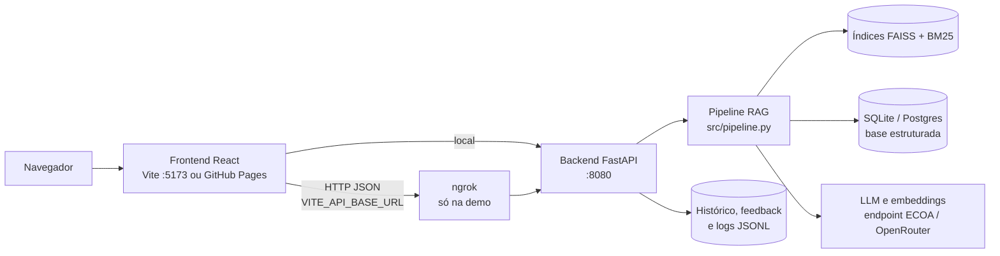
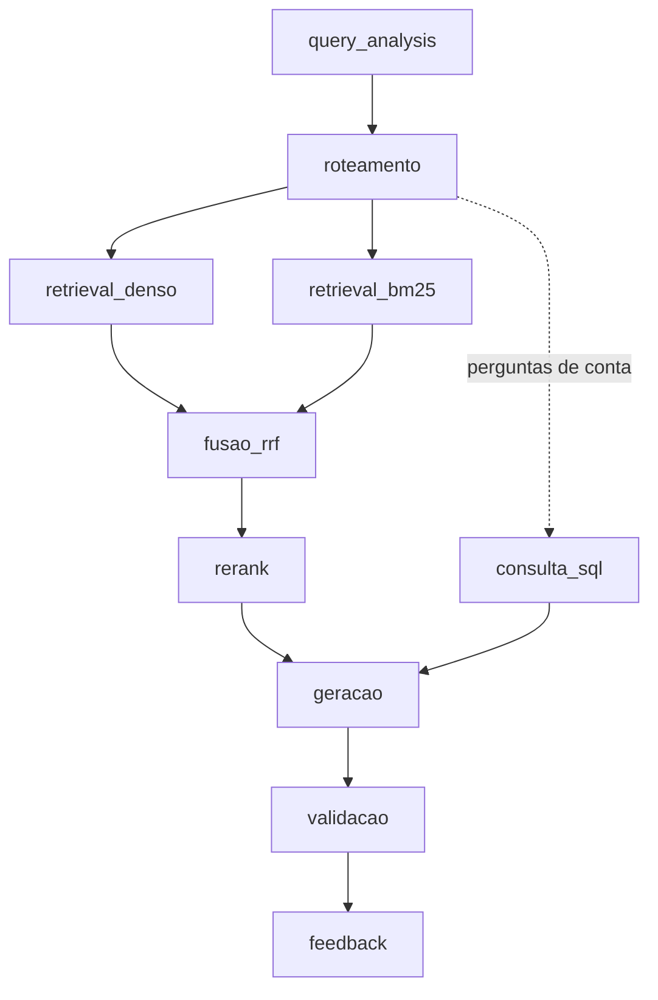

# NEXO RJ — RAG sobre Contratações Públicas do RJ

**Grande Desafio · Cenário 1 · Grupo 04**
**Residência TIC em Trilhas · PUC-Rio · Instituto ECOA**

> **Repositório individual** de Renato Lemos Limongi de Aguiar Moraes. O projeto
> foi desenvolvido em equipe pelo Grupo 04 e entregue em dois repositórios
> separados, um para o backend e outro para o frontend. Este repositório junta o
> conteúdo dos dois num só, para a entrega individual.

O NEXO RJ responde perguntas em linguagem natural sobre as contratações públicas
do Estado do Rio de Janeiro. É um sistema de **Adaptive RAG**: antes de buscar, ele
decide **onde** buscar (norma, registro estruturado, conversa ou número agregado).
Em seguida recupera evidências com busca híbrida (densa + BM25 + RRF + rerank) e
gera uma resposta que cita as fontes. Quando o caso exige, ele recusa a pergunta.

O projeto tem **duas partes**, que aqui ficam em pastas separadas e rodam como
**dois serviços**:

| Parte | Pasta | Tecnologia | Onde roda |
| --- | --- | --- | --- |
| **Backend / RAG** | [Projeto final/rag-grande-desafio-grupo04-cenario01/](Projeto%20final/rag-grande-desafio-grupo04-cenario01/) | Python 3.14 · FastAPI | Máquina local (porta 8080); na demo, exposta por túnel ngrok |
| **Frontend** | [Projeto final/frontendRAG/](Projeto%20final/frontendRAG/) | React 19 · TypeScript · Vite 6 | Local (porta 5173) ou [etuarda.github.io/frontendRAG](https://etuarda.github.io/frontendRAG/) (GitHub Pages) |

O frontend usa **apenas** a API do backend. Não há respostas simuladas nem
catálogo de exemplo: com o backend desligado, a interface mostra erro de conexão.
Subir só o frontend não inicia o RAG.

### Repositórios originais da equipe

| Parte | Repositório da equipe | Pasta neste repositório |
| --- | --- | --- |
| Backend / RAG | [Diogooliveira10/rag-grande-desafio-grupo04-cenario01](https://github.com/Diogooliveira10/rag-grande-desafio-grupo04-cenario01) | `Projeto final/rag-grande-desafio-grupo04-cenario01/` |
| Frontend | [Etuarda/frontendRAG](https://github.com/Etuarda/frontendRAG) | `Projeto final/frontendRAG/` |

O código de cada pasta é uma cópia do repositório da equipe. Os guias de execução
das duas pastas foram ajustados para este repositório: em vez de clonar o outro
projeto, basta entrar na pasta ao lado.

---

## Por que este cenário

Todo órgão público publica suas contratações no [PNCP](https://pncp.gov.br), por
força da Lei 14.133/2021. O portal, porém, só permite consultar um contrato de
cada vez: não dá para cruzar edital, contrato, ata de registro de preços e valores
homologados numa única pergunta. Este projeto constrói essa camada de consulta.

Escolhemos o Cenário 1 por ser o mais verificável: qualquer resposta pode ser
conferida no próprio PNCP. Ele também mostra bem a diferença entre as duas buscas:
número de contrato e CNPJ só aparecem com BM25, e "compra de equipamento
hospitalar" só aparece com embeddings.

## Arquitetura geral



O contrato HTTP entre as partes é mantido no backend:
[docs/FRONTEND_API_CONTRACT.md](Projeto%20final/rag-grande-desafio-grupo04-cenario01/docs/FRONTEND_API_CONTRACT.md).

### Backend: o pipeline RAG



- **Roteamento:** regras determinísticas, sem LLM, escolhem as bases antes da busca.
- **Busca híbrida:** densa (FAISS) + BM25, unidas por RRF e reordenadas por um
  cross-encoder local. O rerank elevou o hit@3 de 0,64 para 0,83.
- **Perguntas de conta** (ranking, média, mediana, evolução): respondidas por SQL
  pré-escrito e parametrizado. O LLM nunca escreve SQL nem reescreve os números.
- **Conversa e continuações:** saudações, pedidos de ajuda e tentativas de injeção
  de prompt recebem resposta fixa, sem LLM. Continuações como "E em 2025?" são
  resolvidas por regras.
- **Sensibilidade:** CPF, telefone e e-mail pessoal são mascarados antes do prompt
  e na resposta. Dados bancários, credenciais e juízo sobre a legalidade de um
  contrato são recusados.
- **Observabilidade:** cada etapa grava log JSONL com `run_id`, latência e tokens,
  numa cadeia de hashes que denuncia adulteração. Histórico e feedback ficam em
  SQLite local.
- **Proteções da API:** limite de requisições por cliente (429 com `Retry-After`),
  cabeçalhos de segurança e CORS liberado só para o GitHub Pages e o Vite local.

### Frontend: a interface

Telas: **Consulta**, **Histórico**, **Feedback**, **Explorar** (contratações,
órgãos, documentos e fontes), **Transparência** e **Sobre**. Cada resposta mostra
as fontes citadas e o trace da consulta (etapas, evidências, filtros e uso do
modelo).

Fluxo do código: `Página/Componente → hook → service → api.ts → FastAPI`.

```text
src/
├── app/         # composição das páginas e navegação
├── pages/       # Consulta, Histórico, Explorar, Sobre...
├── components/  # componentes visuais (sem fetch)
├── hooks/       # estado de tela e chamadas via services
├── services/    # api.ts (cliente HTTP único) + um service por recurso
├── types/       # tipos do contrato e da UI
├── constants/   # rótulos de interface
├── utils/       # formatadores
└── styles/      # global.css
scripts/         # diagnóstico do backend e publicação no Pages
```

## Bases de conhecimento

| Base | Natureza | Conteúdo |
| --- | --- | --- |
| `editais_normativo` | Normativa | Lei 14.133/2021, decretos estaduais e editais |
| `contratos_estruturado` | Estruturada | 106.667 registros do PNCP (compras, empenhos, contratos) |
| `atas_conversacional` | Conversacional | Atas de registro de preços (JSON + PDF, com OCR) |
| `emails_sinteticos` | Conversacional | 25 conversas fictícias (5 restritas), marcadas como sintéticas |
| `pca_agregado` | Agregada | Plano de contratações, itens homologados e indicadores |

O corpus atual é o **v7-reparo**: 144.112 chunks e 144.112 vetores
Qwen3-Embedding-0.6B. O que entra no corpus é definido em
[corpus_manifest.yaml](Projeto%20final/rag-grande-desafio-grupo04-cenario01/corpus_manifest.yaml).

**Avaliação (2026-10-27, v7):** 36/36 no golden set das personas, com 100% de
citação. A suíte do backend tem cerca de 2.400 testes.

---

## Estrutura do repositório

```text
.
├── README.md                                   ← este arquivo (visão geral)
└── Projeto final/
    ├── rag-grande-desafio-grupo04-cenario01/   ← backend / RAG (Python)
    │   ├── app/          ← API FastAPI, CLI e limite de requisições
    │   ├── src/          ← pipeline: coleta, preparação, índice, busca, SQL, geração
    │   ├── eval/         ← golden set das personas e ablações
    │   ├── tests/        ← testes offline (pytest)
    │   ├── docs/         ← contrato da API, observabilidade, relatórios
    │   ├── scripts/      ← setup.ps1 / setup.sh, download de modelos
    │   └── README.md     ← documentação completa do backend
    └── frontendRAG/                            ← frontend (React)
        ├── src/          ← páginas, componentes, hooks e services
        ├── scripts/      ← check:backend, check:query, validação do Pages
        ├── docs/         ← guia local, integração e deploy
        └── README.md     ← documentação completa do frontend
```

---

## Como rodar localmente

**Pré-requisitos:** Git, Python 3.14 (64 bits), Node.js LTS 22+ e cerca de 16 GB
de RAM (a API ocupa de 4,5 a 6 GB). A geração e os embeddings padrão usam o
endpoint compartilhado da turma, portanto é preciso internet.

Use **dois terminais**: um para o backend e outro para o frontend.

### 1. Backend (terminal 1)

```powershell
cd "Projeto final/rag-grande-desafio-grupo04-cenario01"
powershell -ExecutionPolicy Bypass -File scripts\setup.ps1   # Windows
# ou: bash scripts/setup.sh                                  # Linux/macOS
```

O script cria o `.venv`, instala o `requirements-lock.txt` e copia `.env.example`
para `.env`.

**Dados V7 (5,3 GB, fora do Git):** baixe o ZIP com FTS e o `.sha256` na
[pasta do Google Drive](https://drive.google.com/drive/folders/14K1K-q9kze5qivG__b0KvkJV4L7buc1r?usp=drive_link)
e extraia o conteúdo **na raiz do backend**. Os arquivos ficam em
`data/normalized/`, `data/structured/`, `data/config/`, `index/` e
`runtime_bundle.json`. Depois, no `.env`:

```dotenv
SNAPSHOT_MANIFEST=runtime_bundle.json
```

Suba a API:

```powershell
.venv\Scripts\python -m uvicorn app.api:app --host 127.0.0.1 --port 8080
```

A API leva cerca de 1 minuto para subir e mais cerca de 2 minutos para a primeira
validação do `/ready`. Consulte o `/ready` a cada 10 s, sem disparar várias
chamadas ao mesmo tempo, até ele responder 200.

### 2. Frontend (terminal 2)

```bash
cd "Projeto final/frontendRAG"
npm ci
npm run check:backend   # verifica API, corpus e banco (não chama o LLM)
npm run check:query     # envia uma pergunta real e exige resposta com fontes
npm run dev             # http://localhost:5173
```

O `.env.development` já aponta para `http://localhost:8080`. Para usar outra URL,
crie `.env.development.local` e reinicie o Vite. Nunca coloque senhas ou tokens
em variáveis `VITE_*`, porque elas ficam públicas no navegador.

### 3. Primeira pergunta

Na tela **Consulta**, experimente *"O que estabelece a Lei 14.133/2021?"*. A
resposta deve mostrar as fontes. Confira também Explorar, Histórico e o feedback.

A primeira pergunta pode demorar mais, porque o modelo de rerank (~470 MB) é
baixado e carregado. Faça uma pergunta de aquecimento antes de qualquer
apresentação.

### Comandos úteis

| Onde | Comando | O que faz |
| --- | --- | --- |
| Backend | `py app/cli.py rota "..."` | Mostra só as bases escolhidas pelo roteador |
| Backend | `py app/cli.py perguntar "..."` | Pergunta pelo terminal (pipeline completo) |
| Backend | `pytest tests/ -m "not llm"` | Testes offline (os mesmos do CI) |
| Backend | `py .\eval\run_eval.py run --pipeline src.pipeline:responder` | Golden set das personas (desligue a API antes) |
| Backend | `python -m src.log_chain verificar` | Confere a cadeia de hashes dos logs |
| Frontend | `npm test` | Testes offline da interface e dos diagnósticos |
| Frontend | `npm run build` | Checagem de tipos e build em `dist/` |
| Frontend | `npm run check:backend -- --query "..."` | Testa uma pergunta específica contra o backend |

---

## Demo publicada

O backend roda na máquina de quem apresenta e fica público por um túnel
[ngrok](https://ngrok.com) com domínio HTTPS fixo. Não há deploy em nuvem: os
planos gratuitos não comportam o rerank nem os logs em disco.

```powershell
cd "Projeto final/rag-grande-desafio-grupo04-cenario01"
python -m uvicorn app.api:app --host 127.0.0.1 --port 8080
# em outro terminal:
ngrok http --url=https://<dominio>.ngrok-free.dev 8080
```

O frontend é publicado no GitHub Pages por um workflow do GitHub Actions, com o
domínio do túnel em `VITE_API_BASE_URL`. Toda chamada envia o header
`ngrok-skip-browser-warning`, e a origem `https://etuarda.github.io` já está
liberada no CORS do backend. O site só funciona enquanto o backend e o túnel
estiverem no ar; como o domínio é fixo, reiniciar não exige publicar o frontend
de novo.

> **Atenção:** o GitHub só executa workflows da pasta `.github/` na raiz do
> repositório. Os workflows em `Projeto final/*/.github/workflows/` (testes do
> backend e deploy do frontend) foram mantidos como estavam nos repositórios da
> equipe, mas não rodam neste repositório. A demo publicada é a do repositório
> original do frontend.

---

## Documentação detalhada

**Backend** ([Projeto final/rag-grande-desafio-grupo04-cenario01/](Projeto%20final/rag-grande-desafio-grupo04-cenario01/))
- [README.md](Projeto%20final/rag-grande-desafio-grupo04-cenario01/README.md): coleta, preparação, embeddings, índice, SQL, configuração do `.env` e endpoint de modelos
- [ARQUITETURA.md](Projeto%20final/rag-grande-desafio-grupo04-cenario01/ARQUITETURA.md): pipeline, estágios e camadas
- [PERSONAS.md](Projeto%20final/rag-grande-desafio-grupo04-cenario01/PERSONAS.md): personas e perguntas de referência
- [CORPUS_INVENTORY.md](Projeto%20final/rag-grande-desafio-grupo04-cenario01/CORPUS_INVENTORY.md): inventário do corpus
- [docs/FRONTEND_API_CONTRACT.md](Projeto%20final/rag-grande-desafio-grupo04-cenario01/docs/FRONTEND_API_CONTRACT.md): contrato HTTP usado pelo frontend
- [docs/OBSERVABILIDADE.md](Projeto%20final/rag-grande-desafio-grupo04-cenario01/docs/OBSERVABILIDADE.md): contrato dos logs
- [docs/REPARO_V7.md](Projeto%20final/rag-grande-desafio-grupo04-cenario01/docs/REPARO_V7.md): pacote de dados V7, checksum e rollback
- [docs/GUIA_INTEGRACAO_LOCAL_FRONTEND_BACKEND.md](Projeto%20final/rag-grande-desafio-grupo04-cenario01/docs/GUIA_INTEGRACAO_LOCAL_FRONTEND_BACKEND.md): integração local

**Frontend** ([Projeto final/frontendRAG/](Projeto%20final/frontendRAG/))
- [README.md](Projeto%20final/frontendRAG/README.md): scripts, stack e publicação
- [docs/GUIA_EXECUCAO_LOCAL.md](Projeto%20final/frontendRAG/docs/GUIA_EXECUCAO_LOCAL.md): execução local passo a passo e solução de problemas
- [docs/FRONTEND_INTEGRATION.md](Projeto%20final/frontendRAG/docs/FRONTEND_INTEGRATION.md): endpoints, estados de tela e testes
- [docs/DEPLOY_GITHUB_PAGES.md](Projeto%20final/frontendRAG/docs/DEPLOY_GITHUB_PAGES.md): publicação no GitHub Pages

---

*TIC em Trilhas · PUC-Rio · Instituto ECOA · MCTI Futuro · Softex*
